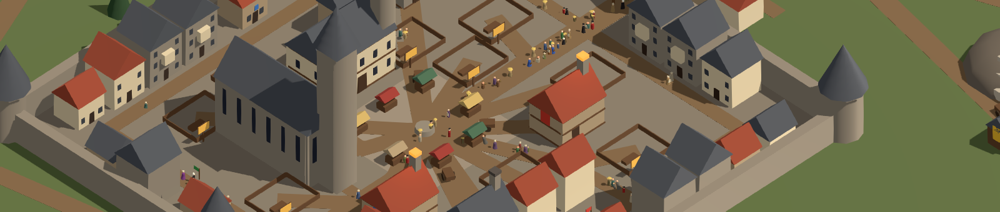

<div align="center">

# Reichsgilde

**Wirtschaftssimulation und Dynastie-Sandbox im 2,5D-Stil** – inspiriert von „Die Gilde“ (Europa 1400)

*Ein düster-bodenständiges Heiliges Römisches Reich des Spätmittelalters: Menschen, Zwerge, Elben und Halblinge leben als Bürger in der Stadt, Orks und Oger lauern als Bestien vor den Toren.*

[](https://github.com/B411Y/reichsgilde/actions/workflows/build.yml)


[](LICENSE) [](LICENSE-INHALTE.md)



*Arbeitstitel · Hobby- und Lernprojekt · Grafikstil: Oberfläche als kolorierter Holzschnitt des Spätmittelalters, die 3D-Welt gemalt-realistisch (im Aufbau, vieles noch aus einfachen Grundformen)*

</div>

## Was das Spiel schon kann

| | Thema | Was schon geht |
|---|---|---|
| 🏰 | [Stadt und Ansicht](#stadt) | Ummauerte Reichsstadt in drehbarer Schrägansicht, Einwohner laufen sichtbar durch die Gassen, Licht und Schatten folgen der Spieluhr; Mauerwerk, Ziegel, Stroh und Holz mit feiner Oberflächenstruktur. |
| 🚪 | [Gebäude betreten](#gebaeude) | Werkstätten, eigenes Wohnhaus, Rathaus und Dom von innen – mit Arbeitern, Familie, Ratsherren und Gläubigen aus der Simulation. |
| 🏗️ | [Bauen und Leerstand](#bauen) | Bauzonen, Wohnhaus und Werkstatt frei bauen (Umriss an der Maus, Rückfrage mit Preis und Bauzeit), leere Häuser kaufen, sanieren oder abreißen, Baustellen und Bauplätze. |
| ⏳ | [Partie und Spieltag](#partie) | Ein Spieltag von 5 bis 22 Uhr ist ein Spieljahr. Hauptmenü, Speichern und Laden, Aktionspunkte für persönliche Handlungen. |
| ⚖️ | [Wirtschaft und Handel](#wirtschaft) | Marktpreise nach Angebot und Nachfrage, Betriebe, Karren und Stadttore, Handel von Hand, Expansion, Meistergrade und Gebäudestufen. |
| ⚒️ | [Berufe](#berufe) | Zehn Berufe – Schmied, Tischler, Steinmetz, Alchimist, Wirt, Prediger, Dieb, Gardist, Geldleiher, Parfumeur – mit eigenen Waren und Kniffen. |
| 🛡️ | [Haus und Dynastie](#haus) | Wappen, Heirat, Kinder, Erbfolge, Talente, Krankheiten und Pest, ein Wohnhaus vom Fachwerkhaus bis zum Stadthof. |
| 👑 | [Stand, Rat und Glaube](#aufstieg) | Vom Gemeinen zum Reichsgrafen, Ämter im Stadtrat, Wahlen und Statut, katholisch, evangelisch oder Naturglaube. |
| 🗝️ | [Unterwelt und Gericht](#unterwelt) | Banden, Einbruch, Brand, Erpressung – und dagegen Wächter, Spitzel, Beweise, Anklage und Kerker. |
| 👥 | [Einwohner](#einwohner) | 25 Einwohner je Haus mit Rolle und Tagesablauf; sie füllen Schänken und Kirchen und kaufen am Markt. |
| 🤖 | [KI-Häuser](#ki) | Bis zu drei Rivalen mit Charakter, die nach denselben Regeln spielen wie du – ohne Schummelei. |

Ein Klick auf ein Thema springt zu seinem Abschnitt im **Spielbuch** weiter unten; dort lässt er sich aufklappen.

## Loslegen

**Du brauchst:**
- [Godot 4.7.x – .NET-Version](https://godotengine.org/download)
- [.NET SDK 8 oder neuer](https://dotnet.microsoft.com/download)
- VS Code mit der C#-Erweiterung (empfohlen)

**Spiel starten:**
1. Godot starten → **Importieren** → `game/project.godot` auswählen.
2. Oben rechts auf **▶ (Projekt ausführen)** klicken oder **F5** drücken – das Hauptmenü erscheint.

Spielstände liegen unter `%APPDATA%\Godot\app_userdata\Reichsgilde\spielstaende` (Windows) bzw. `~/.local/share/godot/app_userdata/Reichsgilde/spielstaende` (Linux).

<details>
<summary><b>Steuerung</b></summary>

- **Leertaste** = Pause · **1–4** = Tempo 1×/2×/4×/8× · **5–6** = Testtempo 16×/32× (nur während der Entwicklung)
- **Mausrad** = Zoom · **rechte Maustaste ziehen** oder **WASD/Pfeiltasten** = verschieben · **Q/E** = drehen
- **Namen in der Stadt:** Ein Gebäude zeigt seinen Namen, wenn die Maus darüber steht oder es ausgewählt ist; **Alt gedrückt halten** zeigt alle Namen. Freie Plätze tragen ein Schild am Pfosten: **ocker = zu verkaufen**, **grün = zu verpachten**.
- **Linksklick** auf ein Gebäude = Informationen (bei eigenen Betrieben mit Bedienfeld) · **Doppelklick** auf eine Werkstatt, das Rathaus oder den Dom = hineingehen · im Gebäude: **Raumleiste** oder **Q/E** = Raum wechseln, **Klick in den Raum** = seine Tafel
- **Bauen** (Knopf im Kontor): Gebäude wählen, dann folgt ein Umriss der Maus – **grün** = hier erlaubt, **rot** = nicht (der Grund steht dabei) · **R** = drehen · **Klick** = setzen (danach Rückfrage) · **Rechtsklick** oder **Esc** = zurück
- **Esc** = Rückfrage oder Baumodus schließen → Tafel schließen → Gebäude verlassen → Auswahl schließen → Spielmenü (Speichern, Laden, Hauptmenü)
- **F11** = Vollbild ein/aus (wird gespeichert).
- **Einstellungen** (Knopf im Hauptmenü und im Spielmenü, Esc): Vollbild, **Oberflächendetails** (Schalter, Standard An), **Kantenglättung** – Aus, FXAA, SMAA (Standard), TAA, MSAA 2×/4×/8× – und **Schattenqualität** – Niedrig, Mittel, Hoch (Standard) – **Bloom** (Schalter und Stärkeregler 0–100 %, Standard An mit 50 %), **Umgebungsverdeckung** (Aus, Niedrig, Mittel als Standard, Hoch), **Indirektes Licht (SSIL)** (Standard Aus) und **FSR 2.2 (Hochskalierung)** (Standard Aus, dann mit Regler „Renderauflösung“ 25–100 %, Standard 67 %; solange FSR an ist, ist die Kantenglättung ausgegraut), je mit kurzer Erklärung. Die Wahl wirkt sofort und wird gespeichert. Niedrig hilft schwachen Grafikkarten (kleinere Schattenkarte, weniger Proben je Bildpunkt). Das Fenster lässt sich frei ziehen: Ein größeres Fenster zeigt mehr Stadt, Tafeln, die nicht hineinpassen, bekommen Scrollbalken (Mausrad über der Tafel rollt sie).
  Hinweis: Startet man das Spiel im Godot-Editor, läuft es im Reiter „Game“ eingebettet. Dort bestimmt der Editor die Fenstergröße, und Vollbild ist nicht möglich. Zum Testen im eigenen Fenster das Einbetten im Reiter „Game“ ausschalten.

</details>

<details>
<summary><b>Tests ausführen</b></summary>

Im Terminal (in VS Code: *Terminal → Neues Terminal*) im Ordner `reichsgilde`:

```
dotnet run --project tests/Reichsgilde.Core.Tests
```

Am Ende muss stehen: `Alle … Tests bestanden.`

</details>

<details>
<summary><b>Spiel exportieren (Windows / Linux)</b></summary>

1. Einmalig in Godot: **Editor → Exportvorlagen verwalten → Herunterladen und installieren**
2. **Projekt → Exportieren…** → Vorlage **Windows** oder **Linux** wählen → **Projekt exportieren**
3. Das fertige Spiel landet im Ordner `build/` (wird nicht ins Repository übernommen)

</details>

## Spielbuch

Alles, was das Spiel kann, im Detail – zum Aufklappen.

<!-- Neues bitte in den passenden aufklappbaren Abschnitt schreiben, nicht ans Ende.
     Nach <summary>…</summary> und vor </details> muss eine Leerzeile stehen, sonst zeigt GitHub kein Markdown. -->

<a id="stadt"></a>
<details>
<summary><b>Stadt und Ansicht</b> – Reichsstadt in Schrägansicht, Passanten, Tag und Nacht</summary>

Die Reichsstadt ist als begehbare Schrägansicht zu sehen: Mauer (100 × 100 m) mit Ost- und Westtor, Wohnhäuser der Spielhäuser am Ring (Fachwerkhaus bis Stadthof, das Stadtpalais aus hellem Haustein mit Erker und zwei Ecktürmchen, der Stadthof mit Haupthaus, Treppenturm, zwei Flügeln und Torhaus, mit Gerüst beim Ausbau, nach Brand rußig, im Leerstand vernagelt), Wohnhäuser der Einwohner am Mauerring (Ratsherren- und Bürgerhäuser nächst dem Markt, mit mehr Spielhäusern eine Vorstadt vor dem Osttor) als Modelle in je drei Varianten und gedeckten Hausfarben, deren Fenster nachts leuchten, Weide, Feld und Holzschläge vor dem Westtor, **Passanten**: die Einwohner laufen sichtbar zu Markt, Gassen, Tor und Umland und verschwinden in Häusern, Schänken, Kirchen und dem Rathaus – bei den Häusern mit Modell, im Dom und im Rathaus erst an der Tür, die Stufen hinauf; man erkennt Volk und Rolle an Gestalt und Tracht, ein Klick zeigt Name, Rolle, Tun und Stimmung. Die Werkstätten der zehn Berufe stehen als Modelle aus Blender da (siehe „Werkstätten als Modelle“); Rathaus (Markthalle mit Ratssaal in Fachwerk und Uhrturm), Dom (gotisch mit Westturm) und Stadtmauer (Mauerstücke mit Zinnen, Mauer- und Ecktürme, Torburgen mit Fallgitter und Stadtwappen) sind ebenfalls Modelle, ebenso der Marktplatz mit Brunnen, Marktkreuz, Bänken und Ständen und die Betriebe vor der Stadt (siehe „Umland und Natur“). Die orthografische Kamera blickt diagonal (nach Nordosten, Nordwesten, Südwesten oder Südosten) und dreht in 90°-Schritten. Karren fahren sichtbar zum Markt, **Tauben und Spatzen** sitzen in Schwärmen auf den Firsten, fliegen von Haus zu Haus, picken auf Markt, Gassen und Wiesen vor der Stadt, fliegen vor Passanten auf und schlafen nachts auf den Dächern, Licht, Schatten und Himmel folgen der Spieluhr (flüssig, nicht minutenweise), die Glut der Werkstätten leuchtet bei Arbeit, Gebäude lassen sich anklicken.

**Tag und Nacht.** Sonne und Mond wandern über den Himmel und werfen beide Schatten. Der Tag gleitet ohne Sprung in die Nacht: Ab etwa 18 Uhr färbt sich das Licht zum Abendrot, die Sonne sinkt bis 20 Uhr zum Horizont und blendet dabei aus, danach geht der Mond im Osten auf, ab 21 Uhr ist richtig Nacht. Morgens ist es umgekehrt: Um 5 Uhr liegt die Stadt noch im Mondlicht (so wie um 22 Uhr, wenn die Uhr ins nächste Jahr springt), ab halb sechs geht die Sonne im Morgenrot auf. Das Licht hinter den Fenstern wird in der Dämmerung nach und nach heller bzw. erlischt. Springt die Uhr (Jahreswechsel, Laden), blendet das Licht in anderthalb Sekunden über.

**Passanten und Markt.** Die Einwohner sind Figuren mit Skelett, je Volk ein eigenes Modell (Mensch, Zwerg mit Bart, Elb, Halbling), Männer und Frauen (Frauen etwas kleiner), mit der Tracht ihrer Rolle (Strohhut, Barett, Kapuze, Haube, Schleier, Schürze, Kiepe, Bündel, Tasche, Stab). Sie bewegen sich nach dem, was sie tun: Sie gehen, eilen, schleppen ihre Last, Bettler und Alte gehen gebeugt – im Takt ihres Tempos, sodass die Füße nicht rutschen. Auf dem Feld hacken sie, im Wald heben sie Holz auf, auf der Weide hüten sie. Auf dem Marktplatz stehen sie als Kunden an den Ständen, plaudern in kleinen Runden, holen Wasser am Brunnen, sitzen auf den Bänken oder schlendern den Rundgang entlang; im Dom sitzen sie auf den Bänken. Jeder Stand legt die Waren eines Handwerks aus (Eisenwaren, Holzwaren, Steinwaren, Tinkturen, Bier und Brot, Kerzen und Bücher, Düfte, Rohstoffe): zuerst die, die Spieler und KI-Häuser gerade auf den Markt gebracht haben, die übrigen Stände füllt die Grundversorgung der Stadt – von der Arbeitszeit des ersten Tages an sind die Stände also voll (sieben Stände, acht Warengruppen: die kleinste fehlt). Dahinter steht zur Arbeitszeit ein Verkäufer. Wer zum Markt geht, betritt den Platz am Rand, wo seine Gasse auf das Pflaster trifft, und geht von dort direkt zu seiner Stelle; Brunnen, Marktkreuz, Bänke und Stände umgeht er, ebenso wer nur über den Platz hindurch will (`--wegenetz=1` zeigt die Gassen, die auf den Platz zulaufen). Figuren außerhalb des Bildes werden nicht bewegt, ganz herausgezoomt seltener – das spart Rechenzeit. Ausprobieren: `--blick=2,4,25 --ui=0` (Markt nah), `--innen=Dom` zur Messe um 10 Uhr.

**Schatten.** Schatten setzen genau am Fuß an – bei Passanten, Marktständen, Masten und Fahnen; das flatternde Tuch wirft einen flatternden Schatten. Wie fein sie sind, stellt die **Schattenqualität** in den Einstellungen ein.

**Bloom.** Lichtquellen leuchten weich nach: das Licht hinter den Fenstern bei Nacht, die Glut der Werkstätten, die Domfenster und das Fensterglas der Raumansicht. Sonnenbeschienene Dächer und Wände bleiben klar, es schimmert nichts bei Tag. In den Einstellungen lässt sich der Bloom ausschalten und seine Stärke regeln (50 % ist das empfohlene Bild, 100 % deutlich kräftiger). Zum Ausprobieren: `--startstunde=21 --bloomstaerke=100` oder `--bloom=Aus`.

**Umgebungsverdeckung und indirektes Licht.** Ecken, Fugen und Fußpunkte werden ein wenig dunkler: Häuser, Marktstände und Mauern stehen fester auf dem Boden, in der Raumansicht werden Raumecken und Möbelfüße betont. Es bleibt dezent – kein grauer Schleier über Flächen. Die Stufen Niedrig, Mittel und Hoch unterscheiden sich in Feinheit und Rechenaufwand. Das **indirekte Licht (SSIL)** lässt Flächen etwas Farbe auf ihre Nachbarn zurückstrahlen, ist zurückhaltend abgestimmt und standardmäßig aus. Zum Ausprobieren: `--ssao=Hoch` oder `--ssao=Aus`, `--ssil=An`.

**FSR 2.2 (Hochskalierung).** Mit FSR rechnet das Spiel das 3D-Bild in kleinerer Auflösung (Regler „Renderauflösung“, 67 % entspricht AMDs Stufe „Qualität“) und holt es aus den letzten Bildern auf volle Größe zurück. Das spart Grafikleistung, bei schwächeren Karten sind damit höhere Einstellungen bei Schatten und Verdeckung möglich. FSR glättet die Kanten selbst, darum ruht die Kantenglättung der Einstellungen, solange es an ist, und gilt danach wieder. Beschriftungen in der Stadt werden bei sehr niedriger Auflösung unscharf, bewegte Fahnen können leicht krümeln. Zum Ausprobieren: `--fsr=An --renderaufloesung=50`.

**Oberflächendetails.** Die Modelle behalten ihre Farben und bekommen eine feine Struktur je Material: Mauern zeigen Quader mit leichten Farbunterschieden und weichen Fugen, Mauerkronen und Gassen Kopfsteinpflaster, Balken und Bretter Maserung mit Ästen, Dächer einzelne Ziegel oder Schieferplatten mit etwas Abnutzung und Stroh seine Halme, Bäume Blätter, Wiesen und Wege Körnung und große, unregelmäßige Flecken; dazu eine leichte Unebenheit im Licht. Das gilt in der Stadt, im Umland und in den Innenräumen, auch für Neubauten, neue Karren und Figuren, für die Farben der Besitzer und die Jahreszeiten. Glut, Fensterlicht, Glas und Wasser behalten ihr Aussehen; wo ein Modell Steine oder Dielen schon als Form hat, kommt keine zweite Struktur dazu. In den Einstellungen lassen sich die Details für schwache Rechner abschalten (Standard: an); dann zeigen die Modelle nur ihre Farben (auf der Testkarte NVIDIA T400 sind die Details etwa 6 % der Bilder je Sekunde wert, die Zahl der Zeichenaufrufe bleibt gleich). Zum Ausprobieren: `--oberflaeche=Aus`.

**Fahnen im Wind.** Alle Fahnen der Stadt flattern: auf den Wohnhäusern, am Wachturm, am Schilderhäuschen der Wache und auf den Werkstätten. Das Tuch hängt am Mast fest und schlägt am freien Ende am stärksten aus; Falten fangen Licht und Schatten. Jede Fahne flattert in ihrem eigenen Takt. Die Grafikkarte rechnet das mit einem kleinen Programm (Shader), der Wind ist für alle gleich und fest.

**Verkaufte Werkstätten.** Wer eine Werkstatt verkauft, lässt das Haus stehen: in seiner Stufe, aber ohne Wappen und Fahne, Tor und Fenster vernagelt, die Scheiben dunkel, davor das ockerfarbene Schild „zu verkaufen“. Ein Klick darauf bietet es zum Kauf an; betreten lässt es sich erst wieder nach dem Kauf. Eine gekündigte Pacht wird wieder leere Grube bzw. freier Umlandplatz mit grünem Schild.

**Werkstätten als Modelle.** Die zehn Werkstätten der Stadt (Schmied, Tischler, Steinmetz, Alchimist, Wirt, Prediger, Dieb, Gardist, Geldleiher, Parfumeur) stehen als Modelle aus Blender da, nicht mehr als Quader: Jede Stufe zeigt ihren Ausbau (zum Beispiel Gießerei, Schmiede, Goldschmiede), beim Umbau steht ein Gerüst davor, Tür, Fensterläden, Wappen und Fahne tragen die Farbe des Hauses. Wird gearbeitet, **glüht** die Esse, der Ofen oder der Athanor der Werkstatt, sonst nicht. **Bei Nacht brennt Licht in den Fenstern** (ab 18 Uhr nach und nach heller, ab halb sechs morgens verlöschend), in leeren und verkauften Häusern bleibt es dunkel. Karren halten am Halteplatz vor dem Tor des Modells. Die Modelle sind 16 × 14 m groß, und so groß sind auch ihre Plätze in der Stadt: Keine Werkstatt stößt an ein Nachbarhaus, jede hat ihren Vorplatz mit einer Gasse zum Markt.

**Umland und Natur.** Die acht Umlandbetriebe stehen als Modelle da: Grube mit Felshang, Stollen, Gleis und Förderwagen (dahinter ein großer Felsberg mit Gras und Tannen, so gestellt, dass er Wegen und Nachbarn nicht in die Quere kommt), Holzschlag mit Blockhütte und Polter, Steinbruch mit abgetreppter Bruchwand und Dreibein, Kräutergarten mit Beeten und Krötenteich, Duftgarten mit Lavendel und Laubengang, Bauernhof mit Fachwerkscheune und Bockwindmühle, Klosterhof mit Zellenhaus, Beeten und Wegkreuz, Wachturm mit Zinnen und Palisade. Jeder dreht seine Vorderseite zur Straße; dort endet der Weg, und die Karren halten. Die Fahne trägt die Farbe des Besitzers, die Glut der Grubenlampe und des Feuerkorbs leuchtet bei Arbeit (der Feuerkorb des Wachturms auch nachts, solange ein Gardist Wache hält). Ein freier Platz zeigt dasselbe Haus verlassen, mit Brettern und Unkraut und dem Schild „zu verpachten“. Weide, Feld und Wald der Einwohner vor dem Westtor sind ebenfalls Modelle. Der Wald um die Stadt besteht aus Tannen, im Westen auch Eichen und Buchen, dazwischen liegen locker Gruppen aus Büschen, Wiesenblumen, Steinen und Totholz, am Bach beim Kräutergarten stehen Kopfweiden mit Schilf; alles steht bei jedem Start an derselben Stelle. Das Laub folgt der Jahreszeit: Im Herbst werden die Blätter gelb, orange und braun. Im Winter stehen Eichen, Buchen, Linden, Kopfweiden und die Laubbüsche kahl da (Tannen, Ginster und Wacholder bleiben grün), die Linden an Wirt, Prediger, Geldleiher, Kräutergarten und Klosterhof zeigen ihre Äste, und das übrige Laub (Hecken, Beete, Weide) verdorrt zu Stroh und Braun; im Frühling kommt das Grün zurück. Zum Ausprobieren: `--spulen=2040` lässt zwei Spieljahre ablaufen, dann ist Herbst, `--spulen=3060` drei, dann ist Winter.

**Karren als Modelle.** Hand-, Ochsen- und Kriegskarren fahren als Modelle mit Zugtieren durch die Stadt: Der Handkarren hat zwei Holme, der Ochsenkarren große Speichenräder und ein Joch, der Kriegskarren ist ein Wehrwagen mit hohen Bohlenwänden und zwei Pferden. Beim **Fahren** drehen sich die Räder genau so schnell, wie der Karren rollt (bei hohem Tempo ruhen sie lieber, als zu flimmern), die Tiere gehen und der Wagen wippt; am Hof **stehen** die Karren, die Tiere nicken und schlagen mit dem Schwanz. Wie viele Sorten Ware geladen sind, zeigen Kisten, Säcke und Fässer (ein Handkarren trägt eine Sorte, ein Ochsenkarren zwei, ein Kriegskarren drei), darüber liegt eine **Plane in der Farbe des Besitzers**. Ein **Mensch** geht am Karren mit: ein Knecht zieht den Handkarren zwischen den Holmen, ein Treiber führt den Ochsen, ein Kutscher sitzt auf dem Bock des Kriegskarrens; sie gehen im Takt der Räder und stehen, wenn der Karren hält. Am Markt halten die Karren am Rand des Platzes und wenden, statt im Brunnen zu stehen. Karren außerhalb des Bildes werden nicht animiert. Zum Ausprobieren kauft `--karren=Ochsenkarren,Kriegskarren` (mit `--vermoegen=9000`) der eigenen Werkstatt gleich Karren dazu.

</details>

<a id="gebaeude"></a>
<details>
<summary><b>Gebäude betreten</b> – Werkstätten, Wohnhaus, Rathaus und Dom von innen</summary>

**Raumansicht – Gebäude betreten.** Ein Doppelklick auf eine Werkstatt, das eigene Wohnhaus oder das Rathaus führt hinein: Eine eigene Kamera blickt fest in einen Raum, wie auf eine Bühne (Rückwand mit Fenstern, Seitenwände, die Vorderseite offen). Die **Raumleiste** unten rechts oder **Q/E** wechseln den Raum, ein **Klick in den Raum** öffnet seine Tafel, **Esc** führt zurück in die Stadt. Fenster und Licht folgen der Uhrzeit. Im Raum bleibt das Bild frei: Gebäudefenster und Kontor des Hauses erscheinen nur in Kontor und Amtsstube.
- **Werkstatt:** **Werkraum** (Einrichtung des Berufs, siehe Tabelle; heißt je Beruf Werkstatt, Schankstube, Kirchenraum, Versteck, Wachstube, Wechselstube, Siedestube oder Laboratorium) · **Lager** (Kistenstapel je Ware, eine Kiste je 5 Stück).
- **Eigenes Wohnhaus:** **Wohnstube** (Herd, Tisch, Bett; Ehepartner und Kinder aus dem Familienbuch, das Oberhaupt nach Feierabend; Klick öffnet die Familie) · **Kontor** (Schreibpult, Aktenregal, Geldtruhe, Wandbehang in der Hausfarbe; tagsüber schreibt dort das Oberhaupt). Mit der Stufe des Hauses kommt Schmuck dazu: Teppiche und Tellerbord (Bürgerhaus), Wandbehang und Landkarte (Steinhaus), Kronleuchter und zweite Truhe (Stadtpalais), Wappen (Stadthof). Die Häuser der Rivalen bleiben zu.
- **Werkstatt wie in der „Gilde“ (neu):** Jeder Arbeiter ist einzeln da, mit eigener Ware, Laune, Dienstjahren und Tempo. Man kann ihm eine Ware zuteilen, ihn entlassen oder – nach der Dienstzeit – vom Lehrling zum Gesellen befördern. Die **Lohnstufe** (knapp, üblich, gut) bestimmt Lohn und Laune; eine **Prämie** hebt die Laune eine Weile. Wem es zu lange schlecht geht, der kündigt, und schlechte Laune macht langsamer. Es gibt **Unfälle**: Ein Verletzter fällt einige Spieltage aus, der Lohn läuft weiter, und die Stimmung im Haus sinkt. Der Lohn wird wie bisher am Jahresende abgerechnet. Die **Einrichtung** des Schmieds ist kaufbar und wirkt: Gutes Werkzeug und Meisterwerkzeug (10 % schneller je Stück), Großer Blasebalg (schneller bei Beschlag, Rapier, Werkzeug und Prunkschwert), Regale (mehr Lager je Ware), Löschfass (Brand halb so wahrscheinlich), Eisentür (Einbruch halb so wahrscheinlich) und Lederschürzen (Unfälle halb so oft).
- **Die Werkstatt des Schmieds (neu)** ist ein eigenes Modell und lässt sich bedienen wie in der „Gilde“: Die Kamera steht auf festen Blickpunkten; **fahrt mit der Maus an den Bildrand** (kurz verweilen), und sie schwenkt zum nächsten – goldene Pfeile am Rand zeigen, wie oft es dort noch geht (einfach, doppelt, keiner). **Rechtsklick** verlässt das Haus. Unter der Maus steht der Name des Gegenstands, der Tür oder des Arbeiters. Ein Klick auf einen Gegenstand öffnet seine Tafel: **Personalbuch** (Arbeiter einstellen, entlassen, befördern; Lohnstufe knapp, üblich oder gut; Prämie), **Amboss und Werkbank** (Waren, Zutaten, Fortschritt; Arbeiter einer Ware zuteilen), **Regal und Kisten** (Bestand, Zurückhalten), **Hoftor** (Karren) und **Werkzeugwand** (Einrichtung kaufen – gekaufte Stücke stehen sofort im Raum). Arbeiter lassen sich anklicken oder mit gedrückter linker Taste in einem Rahmen auswählen und dann in der Produktion einer Ware zuteilen. Stufe, Glut, Werkstücke und Warenstapel folgen der Simulation. Der zweite Schlot im Dachboden steht erst ab der Schmiede (Stufe 2). Die anderen Berufe bekommen ihre Räume nach und nach.
- **Die Werkstatt des Tischlers (neu)** ist ebenfalls ein eigenes Modell und wird genauso bedient: **Hobelbank und Leimtisch** (Produktion), **Bretter und Kisten** (Lager), Personalbuch, Hoftor und Werkzeugwand. Wer die Werkstatt zum **Sägewerk** ausbaut, bekommt als dritten Raum eine **Sägehalle** mit Gattersäge: Sie steht sofort in der Raumleiste (und bei Q/E), und erst ab dann gibt es die Tür dorthin; vorher fehlen Raum, Tür und Knopf. Die Arbeiter hobeln mit dem Hobel, sägen mit der Handsäge am Sägebock, drechseln an der Wippdrehbank (der Fuß tritt im Takt das Pedal) und schieben an der Gattersäge den Stamm nach; Drechselbank und Gatter laufen, solange gearbeitet wird, und die Laterne brennt dann auch. **Hobelspäne** unter der Hobelbank werden über den Arbeitstag mehr (ab 10, 13 und 16 Uhr, wenn gearbeitet wurde) und sind zum nächsten Jahr weggefegt.
- **Die Werkstatt des Steinmetzen (neu)** ist das dritte Raummodell und wird wie die anderen bedient: **Werkblock** (Produktion), **Quader und Kisten** (Lager), Personalbuch, Hoftor und Werkzeugwand. Die Arbeiter behauen den Stein am Werkblock mit **Schlägel und Meißel** und treten den **Schleifstein** (Tritt und Kurbel laufen im Takt des Fußes). Wer zur Steinschneiderei ausbaut, bekommt im Werkraum eine **Steinsäge** mit Hebezeug (der Rahmen geht im Takt der sägenden Hand vor und zurück, die Figur trägt dazu keine Handsäge). Wer zur Steinmetzhütte ausbaut, bekommt als dritten Raum eine **Bauhütte** hinter dem Werkraum (Knopf „Bauhütte“ und Tür erst ab dann), in der ein **Bildhauer** an einer Steinfigur arbeitet. Schleifstein, Säge und Flaschenzug laufen, solange gearbeitet wird, und die Laterne brennt dann auch. **Steinsplitter und Staub** unter Werkblock, Schleifstein und Säge werden über den Arbeitstag mehr (ab 10, 13 und 16 Uhr, wenn gearbeitet wurde) und sind zum nächsten Jahr weggefegt; das Werkstück auf dem Block ist grauer Stein, nur zu einem Zehntel zur Farbe der Ware getönt.
- **Die Werkstatt des Alchimisten (neu)** ist das vierte Raummodell: **Kräutertisch und Kessel** (Produktion), **Kräuterbündel im Dachboden und Tresen im Laden** (Lager), Personalbuch, Hoftor und Werkzeugwand; die Tür zum Dachboden ist eine Treppe. Die Arbeiter **mörsern** Kräuter mit dem Stößel, **rühren** den Sud im Kessel mit der Kelle und – ab dem Kräuterladen – **destillieren** am Kolben. Wer zum **Kräuterladen** ausbaut, bekommt einen **Laden** mit Tresen und Tiegelregalen (Knopf „Laden“ und Tür erst ab dann): Je Fertigware des Hauses steht eine Reihe Flaschen und Tiegel in der Farbe der Ware im Regal, bis zu fünf, je voller das Lager; ein Klick auf eine Reihe oder den Tresen öffnet das Lager, verkauft wird weiter über Karren und Markt. Wer zur **Alchimistenstube** ausbaut, bekommt hinter dem Werkraum einen **Laborturm** („Laborturm“ in der Leiste) mit dem Athanor, dessen Feuer ein Arbeiter mit dem Blasebalg hält; der Laden bekommt dann einen Fischgrätboden. Die **Flüssigkeit** in Mörser, Kessel und Kolben hat die Farbe der Ware, über Kessel, Kolben und Athanor steigt bei der Arbeit **Dampf** auf (in der Spielpause steht er still), und die Feuer glühen, solange gearbeitet wird. Beim Betreten nennt das Protokoll jetzt die Gegenstände, die es im Haus gibt (Kräutertisch, Kessel, Tresen …), statt für alle Berufe dieselben.
- Im Werkraum arbeiten während der Arbeitszeit (8–20 Uhr) die Arbeiter – sie hämmern, sägen, rühren oder schreiben, alles direkt aus der Simulation. Jede Gebäudestufe bringt ein eigenes Stück dazu und mehr Arbeitsplätze.
- Der **Dom** ist vorerst noch ein **Diorama**: Ein Doppelklick schneidet ihn in der Stadt auf (Dach und die beiden Wände zur Kamera verschwinden).

| Werkstatt | Einrichtung (Stufe 2 / Stufe 3) | Zustand aus der Simulation |
|---|---|---|
| Gießerei | Esse, Amboss, Werkbank, Wassertrog (Schleifbock / Feinwerktisch) | Glut der Esse, Schleifstein läuft |
| Tischlerei | Sägebock, Hobelbank, Holzlager (Drechselbank / Sägegatter) | Werkstück in der Farbe der Ware, Drechselbank und Gatter laufen |
| Maurerei | Werkblock, Schleifstein mit Tritt, Quaderlager (Steinsäge mit Dreibein und Flaschenzug / Bauhütte mit Steinfigur) | Werkstück in Granitton, Schleifstein, Steinsäge und Flaschenzug laufen |
| Tinkturei | Kessel über dem Feuer, Mörser und Kräutertisch, Kräuterbündel im Dachboden (Destille und Laden mit Tiegelregalen / Laborturm mit Athanor) | Flüssigkeit in der Farbe der Ware, Dampf, Feuer, Waren in den Regalen des Ladens |
| Schänke | Theke, Fässer, Herd, zwei Tische (Würfeltisch / Stammtisch) | Gäste der Stunde an den Tischen, Abgewiesene an der Tür, Barde am Abend, Würfler und Ratsherren, wenn gebucht |
| Kirche | Altar, Kreuz, Leuchter, Bänke, Kanzel, Schreibpult (Kerzenziehgestell, Taufbecken / Reliquienschrein) | Gläubige zur Messe um 10 Uhr, Kollekte in der Schale |
| Diebesnest | Strohlager, Kartentisch, Hehlertisch, Falltür (Fälscherpult / Geiselstuhl) | Tagsüber nur der Hehler (die anderen stehlen am Markt), Diebesgut im Lager, Nadeln für die Aufträge der Nacht, Beute, Geisel |
| Wachhaus | Speergestell, Tisch, Zelle, Kohlebecken (Rüstungsständer / Strohpuppe) | Gefasste Taschendiebe in der Zelle, Sold, freie Razzien |
| Wechselstube | Wechseltisch mit Waage, Geldtruhe, Schreibpult, Regal (zweites Pult / Tresor) | Münzstapel nach der Kasse, Schuldscheine je Kredit, Kunden |
| Siederei | Kupferkessel mit Kühlfass, Trockengestell, Mischtisch (Spindelpresse / Duftorgel) | Duft in der Farbe der Ware, Ofenglut |

**Rathaus und Dom von innen.**
- **Rathaus:** vier Räume – **Ratssaal** (U-Tisch, die Ratsherren sitzen nach Rang, Häuser in ihrer Farbe mit Namensschild, der Bürgermeister trägt die Amtskette, eine Rolle liegt aus, solange ein Antrag läuft), **Gerichtssaal** (Richterpodest; bei einem Verfahren drei Richter, Ankläger und Beklagter, sonst schreibt der Stadtrichter), **Amtsstube** (Stadtschreiber, Stadtkasse, Ständetafel mit eurem Stand) und **Kerker** (hinter Gittern die einsitzenden Oberhäupter, davor ein Wächter). Besetzt ist das Rathaus von 8 bis 20 Uhr. Ein **Klick in den Raum** öffnet seine Tafel: Ratssaal → Stadtrat, Gerichtssaal und Kerker → Stadtgericht; in der Amtsstube steht das Rathausfenster mit dem Knopf zum Aufsteigen.
- **Dom:** Hauptkirche des Stadtglaubens – **katholisch** prunkvoll (Hochaltar mit goldenem Flügelretabel, Marienfigur, Weihrauchfass, Bischof mit Mitra), **evangelisch** schlicht (Abendmahlstisch, Holzkreuz, Pfarrer auf der Kanzel), bei **Glaubensfreiheit** Simultankirche mit Seil im Mittelgang (Katholiken links, Evangelische rechts). Zur Messe um 10 Uhr sitzen die Gläubigen ohne Kirche eines Hauses in den Bänken (eine Figur je fünf Gläubige). Einwohner, die zum Beten in den Dom gehen, sitzen dort einzeln mit ihrer Gestalt und Tracht von draußen, vorne zuerst.

</details>

<a id="bauen"></a>
<details>
<summary><b>Bauen und Leerstand</b> – Bauzonen, Neubau, leere Häuser kaufen und abreißen</summary>

**Bauen.** Der Knopf **Bauen** im Kontor öffnet die Bautafel (statt des Kontors) und zeigt in der Stadt die **Bauzonen** der Karte als farbige Flächen mit 2-m-Raster: orange = Kern, blau = Mauerring, türkis = Vorstadt. Gewählt wird ein Gebäude – **Wohnhaus** (Fachwerkhaus bis Stadthof) oder **Werkstatt** (Stufe 1, je Beruf); jedes nennt Kosten, Maß und Bauzeit. Was das Haus nicht darf (Stand, Handwerk, Geld), ist ausgegraut, der Grund steht darunter. Danach folgt ein **Umriss** der Maus und rastet aufs Raster (oder auf einen Bauplatz) ein: **grün**, wenn dort gebaut werden darf, sonst **rot** mit dem Grund (keine Bauzone, steht schon etwas da, nicht an einer Straße …). Der helle Streifen vorn ist der Vorplatz, die Spitze zeigt zur Straße. **R** dreht in Vierteln, **Q/E** drehen weiter die Kamera. Ein Klick auf grün öffnet die **Rückfrage**: Preis, angerechnetes altes Haus, Kosten beim Baubeginn, Bauzeit und Fertigstellung. Erst „Bauen“ schickt den Befehl.
- **Wohnhaus:** Das alte Haus wird angerechnet; ihr wohnt bis zur Fertigstellung im alten, danach zieht ihr um, und das alte Haus wird abgerissen und zum Bauplatz. Stufe 1–2 dauert ein Spieljahr, ab Stufe 3 zwei. Stadtpalais und Stadthof gibt es nur so (oder als gekauften Leerstand), nicht als Ausbau am Platz.
- **Werkstatt:** Preis einer freien Werkstatt der Stufe 1 plus ein Jahr Unterhalt in bar, ein Spieljahr Bauzeit. Danach öffnet sie wie jede andere (das Modell nach Beruf, in der gewählten Drehung).
- **Baustelle:** Fundament, Mauern, die mit der Bauzeit hochwachsen, zuletzt der Dachstuhl, dazu Gerüst und Holzstapel. Ein Klick nennt, was entsteht und wann es fertig ist; ist es fertig, folgt die Auswahl dem neuen Haus.
- **Bauplatz:** Wiese mit Pflöcken und Schnur, nach einem Abriss. Hier darf jeder bauen, was hineinpasst, auch außerhalb der Bauzonen. Ein **Wohnhausplatz** (der Platz eines abgerissenen Hauses der Karte) nimmt jedes Wohnhaus jeder Stufe auf – es passt sich der Fläche und ihrer Drehung an; eine Werkstatt darf dort nicht stehen.

**Leerstand.** Das Wohnhaus eines bankrotten oder erloschenen Hauses bleibt vernagelt stehen. Ein Klick darauf zeigt zwei Knöpfe: **Kaufen und sanieren** (50 % des Hauswerts plus 20 % Sanierung, abzüglich eures alten Hauses; 4 Stunden, dann zieht ihr ein; nur, wenn das Haus größer ist als eures) und **Abreißen lassen** (50 % plus Abrisskosten; danach ein Bauplatz für jeden). Beide fragen vorher mit der ganzen Rechnung nach; geht etwas nicht, ist der Knopf gesperrt und der Grund steht in der Tafel.

**Zum Ausprobieren** (Startoptionen nach `--`, siehe `CLAUDE.md`): `--bauen=1` öffnet den Baumodus, `--bauen=wohnhaus:1 --bauort=-96,-3,0 --bauklick=1` setzt den Umriss auf eine Probestelle und öffnet die Rückfrage, `--bauklick=2 --spulen=1100` baut gleich und lässt die Bauzeit ablaufen.

</details>

<a id="partie"></a>
<details>
<summary><b>Partie und Spieltag</b> – Hauptmenü, Spieltag 5–22 Uhr, Speichern, Aktionspunkte</summary>

**Spieltag wie im Original: 05:00 bis 22:00 Uhr.** Ein Spieltag ist ein Spieljahr. Er beginnt um 5 Uhr mit der Zunftglocke, gearbeitet wird von 8 bis 20 Uhr, von 20 bis 22 Uhr ist Dunkle Nacht (die Gauner ziehen um 20 Uhr los), um 22 Uhr kommt die Jahresrechnung, und das nächste Jahr beginnt wieder um 5 Uhr. Ein Jahr dauert weiter 15 Minuten Echtzeit (eine Spielstunde ≈ 53 Sekunden). Spielstände aus der Zeit des 24-Stunden-Tags lassen sich nicht mehr laden.

**Hauptmenü, Speichern und Laden.**
- Das Spiel startet im Hauptmenü. Unter „Neue Partie“ wählst du Wappen und Hausname, Siegbedingung, Dauer eines Spieljahres, Startstatut, Startvermögen, den Charakter des Rivalen und den Zufallsstartwert.
- Im Spiel öffnet **Esc** das Spielmenü: Weiterspielen, Speichern, Laden, Hauptmenü, Beenden.
- Nach jedem Jahresbericht wird automatisch gespeichert.
- Ein geladener Spielstand läuft exakt so weiter, wie er gespeichert wurde.

**Aktionspunkte.** Jedes Haus bekommt zum Jahreswechsel **4 Aktionspunkte** (im Hauptmenü 1–12 einstellbar) und kann bis zu 12 ansparen. Persönliche Handlungen kosten AP: Werben, Heiraten, einen Ratsherrn beschenken, sich bewerben, einen Spitzel ansetzen, eine Bande anheuern (je 1), Statut-Antrag, Anklage, Erpresserbrief, Konvertieren, Antrag zum Stadtglauben (je 2), Bekehrungspredigt (1). Mit übrigen AP übt das Oberhaupt ein Talent: ½ Stern je Übung, je Talent einmal im Jahr; es kostet 2 AP unter 3 Sternen, 4 AP unter 5 und 6 AP darüber. Die Wirtschaft (Betriebe, Personal, Karren, Wächter, Stand, Liegenschaften) bleibt frei. Haus Eisenbart hat dieselben AP und setzt Prioritäten nach seinem Charakter.

</details>

<a id="wirtschaft"></a>
<details>
<summary><b>Wirtschaft und Handel</b> – Markt, Betriebe, Karren, Handel von Hand, Expansion, Meistergrade</summary>

**Simulationskern.** Die Spielzeit läuft (1 Runde = 1 Spieltag = 1 Spieljahr, Standard 15 Minuten), mit Pause, Tempo und wählbarer Siegbedingung. Die **Wirtschaft** ist eingebaut: Marktpreise nach Angebot und Nachfrage, Gießerei und Mine produzieren während der Arbeitszeit, Löhne, Pacht und Steuern laufen in die Jahresrechnung, und das Fron- und Sklavenstatut bestimmt, wer wo arbeiten darf. **Lager und Karren** bringen die Waren zum Markt; auf Umland-Wegen lauern **Banditen aller Völker**, gegen die Eskorten helfen. Das Kontor im Spiel zeigt Vermögen, Lager, Karren, Jahresrechnung und Marktpreise.

**Bedienung.** Ein Klick auf deine Gießerei (oder „⚒ Betrieb verwalten“ im Kontor) öffnet das Bedienfeld: Produkt wählen, Personal einstellen und entlassen, Karren kaufen und für Umland-Fahrten Eskorte und Nachtfahrt festlegen, den Betrieb verkaufen. **Stadttore:** Ab 20 Uhr sind die Tore zu, um 5 Uhr gehen sie wieder auf. Ein Umlandkarren, der nach Torschluss ankommt, wartet sicher bis zum Morgen vor dem Tor – außer er darf nachts fahren, dann zahlt er 15 Gulden Torgeld je Durchfahrt. Neben jeder Wahl steht, was sie bringt (Gulden je Arbeitsminute, Jahresertrag je Kopf, erwartete Kosten je Fahrt) – dieselben Rechnungen, nach denen die KI entscheidet. Jede Aktion ist ein **Befehl**, den der Simulationskern prüft und mit Begründung ausführt oder ablehnt; die KI benutzt denselben Weg.

**Marktplatz.** Ein Klick auf den Marktplatz in der Stadt (oder der Knopf „Marktplatz“ im Kontor) öffnet das Marktfenster: alle Waren als Kacheln mit Pixel-Icon und Preis, nach Rohstoffen, Zwischenwaren und Fertigwaren geordnet. Grün ▲ heißt über dem Grundpreis, rot ▼ darunter; die gelbe Zahl im Icon ist der eigene Lagerbestand, der Tooltip zeigt Herkunft, Nachfrage, Zutaten und Gewinn je Arbeitsminute. Neue Icons: Zeichenfunktion in `tools/icons/waren_icons.py` ergänzen und `python3 tools/icons/waren_icons.py` ausführen.

**Handel von Hand.** Oben im Marktfenster (oder über „Handel am Markt …“ in der Betriebsverwaltung) gibt man einem Karren einen **Auftrag**: Betrieb und Karren wählen, Ware anklicken, Menge eintragen, „verkaufen“ (aus dem Lager) oder „kaufen“ (ins Lager). Der Karren lädt, fährt zum Markt, handelt dort und bringt die Einkäufe heim. Eingekauft wird zum Marktpreis **+10 % Händlerspanne** (Verhandeln senkt sie), und jedes gekaufte Stück hebt den Preis, wie jeder Verkauf ihn senkt. Der Markt hat **8–20 Uhr** offen (Ankunft des Karrens). Ist der Karren unterwegs, wird der Auftrag **vorgemerkt** und startet, sobald er zurück ist. **Zurückhalten:** Eine Ware bleibt im Lager, der Karren verkauft sie nicht von selbst – Gekauftes, das der Betrieb nicht verarbeitet, wird automatisch zurückgehalten. Die KI handelt (noch) nicht von Hand.

**Expansion.** Als Bürger kannst du eine zweite Werkstatt kaufen (Gießerei an der Südgasse) oder eine Grube pachten (am Silberberg oder im Tannenwald). Freie Plätze sind in der Stadt mit Zaun und Schild „zu verkaufen“ bzw. „zu verpachten“ markiert. Ein Klick darauf zeigt Preis, Pacht und den erwarteten Gewinn. Jede Liegenschaft gibt es nur einmal, und Haus Eisenbart greift ebenfalls zu.

**Betrieb verkaufen.** Eine Werkstatt, die du nicht mehr brauchst, lässt sich verkaufen: Sie bringt **75 % ihres Werts** (Kaufpreis der Stufe 1 und alle Ausbauten – Gießerei 2.625, Schmiede 4.500, Goldschmiede 8.250 Gulden). Personal, Wächter und Karren gehen mit, die **Lagerware** wird zum Marktpreis −20 % mitverkauft. Löhne und Unterhalt bis zum Verkaufstag werden anteilig fällig. Eine Grube oder ein anderer Umlandbetrieb wird auf dieselbe Weise **gekündigt** (nur die Lagerware bringt Geld). Mindestens ein Betrieb muss bleiben; während eines Umbaus und solange ein Karren unterwegs ist, geht es nicht. Danach steht der Betrieb mit seiner Stufe wieder zum Verkauf – zum vollen Wert und nur für ein Haus mit dem passenden Meistergrad. Das gilt auch für die Werkstätten vom Spielstart. Der Erlös steht im Jahresbericht als „Verkäufe“ neben dem Betriebsgewinn. Die KI-Häuser verkaufen einen Betrieb nach zwei Verlustjahren und vor dem Bankrott (siehe KI-Häuser).

**So geht's:** Im Bedienfeld des Betriebs steht unten „Verkaufen …“ (Umland: „Pacht kündigen …“); ist der Verkauf gerade nicht erlaubt, ist der Knopf gesperrt und der Grund steht daneben. Der Knopf öffnet eine **Rückfrage** mit allen Zahlen: Erlös fürs Haus, Lagerware Stück für Stück mit ihrem Erlös, Löhne und Unterhalt bis heute, die Summe, wer und was mitgeht und bei einer Geldleihe die Kasse, die zurück ins Bargeld kommt. Liegt noch Ware im Lager, steht oben eine **orange Warnung** – oft bringt sie am Markt mehr. Erst „Verkaufen“ in der Rückfrage verkauft; danach zeigt die Auswahl das frei gewordene Haus mit seinem Kaufangebot. Ein freier, schon bebauter Platz zeigt Stufe und nötigen Meistergrad; was zum Kauf fehlt, steht als ⚠-Zeile darunter. Zum Ausprobieren: `--verkaufen=1` öffnet die Rückfrage für die eigene Werkstatt, `--verkaufen=2 --vermoegen=20000` kauft vorher eine Grube dazu und lässt die Stadt bis Mittag laufen, damit der Verkauf erlaubt ist und Ware im Lager liegt.

**Meistergrade und Gebäudestufen.** Jedes Stück, das die Betriebe eines Hauses herstellen oder fördern, bringt Erfahrung im Beruf. Reicht sie, legt man im Kontor die Meisterprüfung ab (Gebühr und 2–4 AP) – bis zum 6. Grad. Ab dem 3. Grad lässt sich die Werkstatt am Platz zur Stufe 2 ausbauen (Schmiede bzw. Drechslerei, 3 Plätze), ab dem 5. Grad zur Stufe 3 (Goldschmiede bzw. Sägewerk, 4 Plätze); der Umbau kostet Gulden und einen halben Arbeitstag. Höhere Stufen stellen wertvollere Waren her: Werkzeug, Silberkette, Goldkette, Prunkschwert; Gehstock, Armbrust, Schrank, Prunktruhe; Säule, Taufbecken, Steinfigur, Grabmal; Rosenwasser, Gegengift, Theriak, Zinnober (Gold gibt es nur auf dem Markt). Der Steinmetz baut zur Steinschneiderei und Steinmetzhütte aus. Der 6. Grad bringt einen Aktionspunkt mehr je Jahr. Grad und Erfahrung gehören dem Haus und gehen beim Erbfall nicht verloren.

</details>

<a id="berufe"></a>
<details>
<summary><b>Berufe</b> – zehn Handwerke von Schmied bis Parfumeur</summary>

**Berufe: Schmied, Tischler, Steinmetz, Alchimist, Wirt, Prediger, Dieb, Gardist, Geldleiher und Parfumeur.** Im Hauptmenü wählt man den Startberuf. Der **Schmied** fördert in der Grube Eisen und Silber und macht in der Gießerei Beschläge, Rapiere und Silberringe. Der **Tischler** schlägt im Holzschlag Holz und macht in der Tischlerei Holzzapfen, Schemel und Truhen – für eine Truhe braucht er einen Beschlag vom Schmied. Der **Steinmetz** bricht im Steinbruch Bruchstein und Granit und macht in der Maurerei Schleifziegel, Grabsteine und Mühlsteine; seine Schleifziegel braucht die Goldschmiede für das Prunkschwert, er selbst braucht in der Steinmetzhütte Werkzeug vom Schmied. Der **Alchimist** zieht im Kräutergarten Kräuter und fängt Kröten und macht in der Tinkturei Farbe, Kräuterschnaps und Heilsalbe; seine Farbe braucht der Tischler für den Schrank. Wer das Handwerk beherrscht, mischt Krötenschleim im Hinterzimmer selbst (halber Preis, höhere Chance). Einen weiteren Beruf erlernt man im Kontor (500 Gulden Lehrgeld, 4 AP); erst dann darf man dessen Werkstätten und Umlandbetriebe erwerben. Neben Haus Eisenbart (Zwerge, Schmiede) spielen **Haus Eichwald** (Elben, Tischler) und **Haus Kieselbach** (Halblinge, Steinmetze) mit; im Hauptmenü lassen sich 1–3 Rivalen wählen. Ist ein KI-Haus Patrizier geworden, darf es einen Betrieb mehr führen und dafür ein zweites Handwerk erlernen. Werkstätten sind in `wirtschaft.json` unter `betriebsarten` und `berufe` beschrieben – ein weiterer Beruf ist vor allem ein Dateneintrag plus ein Platz in der Stadt.

**Wirt.** Der Bauernhof liefert Gerste und Roggen, die Schänke (→ Wirtshaus → Gasthaus) macht Speisen und Bier – und **bewirtet Gäste**: Von 12 Uhr bis zum Ende des Spieltags um 22 Uhr (ab 18 Uhr doppelt so viele) kehren Gäste ein und bestellen, was im Lager ist, zum Ausschankpreis (Grundpreis + 25 %). Die Gäste verteilen sich nach Stufe und Ansehen auf alle Schänken der Stadt; je Ausschankware bleiben 15 Stück für sie im Lager, nur der Rest fährt zum Markt. **Barde** (120 Gulden, einmal je Jahr): abends 50 % mehr Gäste, 10 % höhere Zeche, doppelte Stammtisch-Gunst. **Würfeltisch** (ab Wirtshaus): 4 Gulden je Gast, aber 2 Ansehen weniger. **Stammtisch** (Gasthaus): am Jahresende Gunst bei jedem Ratsherrn – ohne Bestechungsspur. **Dunkle Ecke:** Wer eine Schänke führt, hört am Gerichtstag Gerüchte über die Taten anderer Häuser (Beweise wie vom Spitzel). Alles in der Betriebsverwaltung der Schänke.

**Prediger.** Der Klosterhof liefert Lumpen und Wachs, die Kirche (→ Dom → Kathedrale) macht Papier, Kerzen und Lehrschriften, später Hetzschriften, Psalter, Stundenbücher und Reliquiare. **Messe** um 10 Uhr: Die 200 Gläubigen des Jahres verteilen sich nach Stufe, Ansehen und Rhetorik auf alle Kirchen und spenden je 2,5 Gulden (steuerfrei). **Ablass:** Andere Häuser kaufen im Gerichtssaal eine ihrer Taten frei (250 Gulden + halber Wert der Tat, an den Prediger) – die Tat verfällt mit allen Beweisen; zuerst die, von der andere wissen. **Beichte:** Am Jahresende hört der Prediger von fremden Taten (25 % je Tat); bricht er das Beichtgeheimnis (2 AP), werden daraus Beweise – und er begeht selbst ein Vergehen. **Lehrschrift** (Familientafel, 1 AP, einmal im Jahr): +½ Stern, aber nur bis 3 Sterne. **Hetzschrift** (Hinterzimmer, 1 AP): 5 Ansehen weniger für ein anderes Haus bis Ende nächsten Jahres – eine Verleumdung. Beide Schriften kommen aus dem eigenen Lager oder vom Markt, nutzbar für jeden Beruf.

**Dieb.** Kein Handwerk, keine Ware, kein Umland: Schmugglerloch → Unterschlupf → Diebesgilde (4 / 6 / 8 Diebe). **Taschendiebe** ziehen während der Arbeitszeit über den Markt (≈ 0,8 / 0,88 / 1,04 Gulden je Diebesminute, steuerfrei, Erfahrung wie bei jedem Handwerk). Je Diebesstunde 1,2 % Fangchance (weniger auf höheren Stufen und mit „Bei Nacht und Nebel“): Der Dieb kommt in den Turm, ein anderes Haus erfährt, wem er diente (Spur mit Beweis). Nachts arbeiten die eigenen Leute im Hinterzimmer (1 / 2 / 3 Aufträge je Nacht, kein Geld, nur AP): **Einbruch** (besser als eine Bande, die Beute kommt ins eigene Lager), **Auskundschaften** (Beweise ohne eigene Spur), ab Unterschlupf **Schutzgeld** (wer nicht zahlt, dem brennt ein Betrieb), in der Diebesgilde **Entführung** (Lösegeld bis Ende des Folgejahres, sonst wird die Geisel in die Fremde verkauft; Kerker). Ein Haus mit Dieben hat 3 Ansehen weniger. Nur wagemutige KI-Häuser erlernen den Dieb; jede KI zahlt Lösegeld und wägt Schutzgeld gegen den drohenden Brand ab.

**Gardist.** Das ehrliche Gegenstück zum Dieb – kein Handwerk, keine Ware: Wachhaus → Stadtwache → Garnison (4 / 6 / 8 Wachleute) in der Stadt, dazu ein **Wachturm** an der Landstraße. **Sold:** Die Stadt zahlt für jede Arbeitsminute (0,75 / 0,83 / 0,98 Gulden vor Steuer). **Patrouille:** Jeder Wachmann in der Stadt senkt nachts die Erfolgschance von Diebstahl, Sabotage, Einbruch, Brandstiftung und Entführung in der Stadt um 2,5 % (höchstens 40 %) und macht Zeugen häufiger – zum Schutz aller Häuser. Der **Wachturm** senkt die Überfallchance der Banden auf allen Umlandwegen um bis zu 30 %. **Razzia** (Gerichtssaal → Beweisbuch, 2 AP, 1 / 2 / 3 im Jahr): Die Wache durchsucht ein Haus, findet zu jeder seiner Taten mit 50 % (+10 % je Stufe) einen Beweis und beschlagnahmt das Diebesgut aus seinen Verstecken. **Kopfgeld:** Gewinnt ein Haus der Wache eine Anklage, zahlt die Stadt ein Viertel der Buße; jeder gefasste Taschendieb bringt 50 Gulden. **Geleitschutz:** Die Eskorte „Stadtwache“ (20 Gulden je Fahrt, 80 % Schutz) gibt es nur, solange ein Haus ein Wachhaus führt – das Geld geht an dieses Haus. Ein Haus der Wache hat 3 Ansehen mehr. Nur vorsichtige und ausgewogene KI-Häuser erlernen den Gardisten; sie durchsuchen zuerst Diebesnester.

**Geldleiher.** Kein Handwerk, keine Ware: Wechselstube → Geldleihe → Bankhaus (2 / 3 / 4 Schreiber). **Kasse:** Der Geldleiher legt Bargeld in die Kasse; jeder Schreiber verleiht während der Arbeitszeit bis zu 2.000 Gulden (× 1 / 1,25 / 1,5) an Bürger der Stadt zu 12 % im Jahr. Jedes Jahr fallen mit 20 % Kunden aus – dann sind 10 % der Kasse verloren. **Wechsel:** Auswärtige Kaufleute wechseln ihre Münzen – 0,7 % des Marktumsatzes gehen an die Schreiber der Stadt (≈ 800 Gulden je Geselle und Jahr mit voller Kasse). **Kredite an Häuser:** Im Kontor leiht jedes Haus bei einem Geldleiher (1 AP, ein Kredit zur Zeit, 1–5 Jahre, höchstens die Hälfte des eigenen Reinvermögens; der Geldleiher verleiht 3.000 / 6.000 / 12.000). Den Zins setzt der Geldleiher (4–50 %, Standard 12 %); Zinsen laufen stündlich auf, Zins und Rate sind am Jahresende fällig. Fehlt das Bargeld, pfändet der Büttel Lagerware zu 75 % des Marktpreises. **Wucher:** Über 20 % ist der Schuldschein ein Beweis gegen den Geldleiher, und er hat 5 Ansehen weniger, solange der Kredit läuft. Geldleihe +1 AP, Bankhaus +2 AP je Jahr. **Reinvermögen:** Stand, Rangliste, Ansehen, Bußen, Bankrott und Sieg richten sich nach Bargeld + Verliehenem − Schulden; geliehenes Geld macht nicht reicher. KI-Häuser lernen den Geldleiher wie jeden Beruf, setzen den Zins nach Charakter (10 / 14 / 25 %) und füllen ihre Kasse; selbst leihen sie nicht.

**Parfumeur.** Der Duftgarten liefert Lavendel und Jasmin, die Siederei (→ Duftwerkstatt → Parfumerie) macht **Politur** – die brauchen jetzt auch Goldkette (Schmied) und Prunktruhe (Tischler) –, die Blume der Zwietracht und Giftdolche, später Moschusduft, Fechterduft, Heiligenduft und Schattendolch. Vier Waren wirken, für jedes Haus, aus dem eigenen Lager oder vom Markt: **Moschusduft** bringt in der Brautschau +10 Zuneigung über das Jahreslimit hinaus und im Rat +12 Gunst ohne Bestechungsspur (je Person einmal im Jahr, 1 AP). **Blume der Zwietracht** (Hinterzimmer, 1 AP): Ein Ratsherr verliert 15 Gunst für ein anderes Haus – eine Intrige. **Heiligenduft** (Familientafel, 1 AP): +4 Ansehen bis Ende des nächsten Jahres. **Giftdolch** / **Schattendolch** (Hinterzimmer, 2 AP): In der Nacht wird das Oberhaupt eines Hauses vergiftet (60 % / 80 %); Medicus und Kräuterschnaps helfen nicht, nur **Gegengift** vom Alchimisten – sonst ist es am Ende des nächsten Jahres mit 20 % / 45 % tödlich. Ein Giftanschlag führt vor Gericht in den Kerker. Jede KI kann den Parfumeur lernen und schenkt Moschus, wenn die Geschenke des Jahres nicht reichen; vergiften lässt nur die wagemutige – und nur ein Haus, das anderthalbmal so reich ist.

</details>

<a id="haus"></a>
<details>
<summary><b>Haus und Dynastie</b> – Wappen, Familie, Erbfolge, Talente, Gesundheit, Wohnhaus</summary>

**Wappen und Hausname.** Ganz oben unter „Neue Partie“ wählst du das **Wappen** deines Hauses: eine von zwölf Vorlagen anklicken, die Farben für Grund und Figur ändern oder würfeln. Daneben steht die Beschreibung in der Sprache der Herolde („In Rot ein goldener Hammer.“). Ein Wappen besteht aus einer Teilung (z. B. geteilt, gespalten, Schildhaupt, Balken, Sparren), zwei Farben und einer von 16 Figuren; wo die Figur über die zweite Farbe reicht, wechselt sie die Farbe („verwechselte Farben“). Die KI-Häuser führen eigene Wappen (Eisenbart: in Schwarz ein goldener Amboss; Eichwald: in Grün mit silbernem Bord ein silberner Baum; Kieselbach: in Blau unter silbernem Schildhaupt ein silberner Wellenbalken), die du nicht wählen kannst. Wappen stehen im Kontor, in der Rangliste des Jahresberichts, bei Amtsinhabern im Rat, im Beweisbuch des Gerichts und im Gebäudefenster beim Besitzer. Als Hausname trägst du nur den Namen ein („Hammerschmid“) – das Spiel schreibt überall „Haus Hammerschmid“, wie bei den Rivalen.

**Dynastie.** Dein Haus besteht aus Menschen, Zwergen, Elben oder Halblingen. Volk, Geschlecht und Vorname des Oberhaupts wählst du im Hauptmenü. Jedes Jahr altern alle; mit dem Alter steigt das Sterberisiko. Über „Familie“ im Kontor öffnest du die Familientafel. In der **Brautschau** wirbst du mit Geschenken um ledige Bürger der Stadt, nur standesgemäß und mit etwas Geduld, denn mehr als 20 Zuneigung im Jahr gewinnt niemand. Neben jedem Kandidaten steht, wie viele Kinder die Ehe erwarten lässt. Ehen zwischen Völkern sind erlaubt, aber weniger fruchtbar, und sie wirken sich im Rat aus. Stirbt das Oberhaupt, erbt das im **Testament** bestimmte Kind, sonst das älteste volljährige. Gibt es keines, führt nach dem Witwenrecht der Ehepartner das Haus weiter. Sonst erlischt das Haus, und die Partie ist verloren. Die Völker unterscheiden sich deutlich: Elben leben sehr lange, bekommen aber selten Kinder. Halblinge bekommen schnell Kinder, sterben aber früher. Haus Eisenbart ist ein Zwergenhaus und sucht nach denselben Regeln eine Partie.

**Talente und Ausbildung.** Jede Person hat fünf Talente mit 0 bis 6 Sternen: **Verhandeln** (bessere Markterlöse), **Handwerkskunst** (mehr Leistung aller Arbeitskräfte), **Bei Nacht und Nebel** (Gaunerstücke gelingen öfter, Zeugen sehen weniger), **Kampf** (stärkere Wegelagerer, besser geschützte eigene Karren) und **Rhetorik** (Ratswahlen, Plädoyer vor Gericht, Brautgeschenke). Es zählen die Talente des Oberhaupts, der Erbe ist also eine echte Entscheidung. Die Völker bringen Anlagen mit: Zwerge sind die besten Handwerker, Elben die besten Redner, Halblinge die geschicktesten Gauner. Dazu kommen **Völkerboni je Beruf** (±5 % Leistung und damit Erfahrung, nach dem Volk des Oberhaupts): Menschen als Tischler und Gardist +5 % und ohne Schwächen; Zwerge als Schmied, Steinmetz und Geldleiher +5 %, als Dieb und Parfumeur −5 %; Elben als Alchimist, Prediger und Parfumeur +5 %, als Steinmetz und Gardist −5 %; Halblinge als Wirt und Dieb +5 %, als Schmied und Gardist −5 %. Die KI wählt ihre Zweitberufe danach. Kinder erben die Hälfte vom Mittel der Eltern, den Rest von ihrem Volk, und die Brautschau zeigt die Stärken jedes Kandidaten. In der zweiten Hälfte der Kindheit lernen Kinder in einer **Ausbildung** dazu: Zunftlehre, Kontorlehre, Klosterschule, Fechtmeister, Universität (ab Bürger) oder die Gasse. Haus Eisenbart bildet seine Kinder ebenfalls aus und setzt das begabteste als Erben ein.

**Gesundheit und Krankheiten.** Jedes Jahr erkrankt etwa jede siebte Person: Husten, Ruhr, Lungenentzündung, Knochenbruch, Vergesslichkeit, Angst im Dunkeln, Haarausfall oder Lachanfälle. Krankheiten kosten Talente oder Ansehen, Ruhr und Lungenentzündung können tödlich sein. Alle 25–40 Jahre kommt die **Pest**: Viele erkranken, ein Teil stirbt (Zwerge und Elben sind weniger anfällig), und alle Betriebe arbeiten ein Jahr lang 30 % langsamer. Ein **Medicus** (Gulden) heilt sofort bzw. halbiert das Pestrisiko; **Kräuterschnaps** vom Markt kommt in die Hausapotheke und heilt leichte Krankheiten. Im Hinterzimmer lässt sich einem fremden Oberhaupt **Krötenschleim** ins Essen mischen – das Vergehen heißt Giftmischerei.

**Wohnhaus.** Jedes Haus wohnt in einem eigenen Wohnhaus, getrennt von den Betrieben, und baut es am selben Ort Stufe für Stufe aus: **Fachwerkhaus** (zum Start) → **Bürgerhaus** (1.500 Gulden, 30 im Jahr Unterhalt, +2 Ansehen) → **Steinhaus** (4.000 / 80 / +4) → **Stadtpalais** (10.000 / 200 / +6) → **Stadthof** (25.000 / 500 / +8). Das Haus ist **Pflicht für den Stand**: Bürger wird nur, wer im Bürgerhaus wohnt, Patrizier nur im Steinhaus, Edler im Stadtpalais, Freiherr im Stadthof. Ausbauen darf man höchstens eine Stufe über dem eigenen Stand; ein Ausbau dauert 4 Stunden. In einer Stadt mit Bauzonen (Greybox) geht der Ausbau am Platz nur bis zum Steinhaus: **Stadtpalais und Stadthof** sind größer als ein Wohnhausplatz und entstehen nur als **Neubau** oder durch den **Kauf eines Leerstands** (ein Ausbau, der in einem alten Spielstand schon läuft, wird fertig). Ohne Bauzonen (Köln) bleibt der Ausbau bis zum Stadthof. Im Kontor steht die Zeile „Wohnhaus“ mit dem Knopf zum Ausbauen, der Rathaus-Knopf sagt, wenn das Haus noch fehlt. Der Unterhalt zählt zu den Haushaltskosten. Was in den Ausbau fließt, zählt als **Hauswert ganz zum Reinvermögen** – wer genau an der Schwelle baut, fällt also nicht darunter und kann trotzdem aufsteigen. Die KI-Häuser bauen ihr Wohnhaus selbst aus (oder neu, oder kaufen einen Leerstand), bevor sie aufsteigen. Gegen Einbruch und Brand hilft ein **Hauswächter** (Knopf in derselben Zeile, 150 Gulden im Jahr): Er halbiert die Chance der Banden und sieht öfter, wer es war.

**Leerstand und Neubau.** Das Wohnhaus eines bankrotten oder erloschenen Hauses steht leer. Wer ein größeres Haus will, kann es **kaufen**: 50 % des Hauswerts plus 20 % Sanierung, abzüglich des Hauswerts des eigenen Hauses (keine Auszahlung, höchstens eine Stufe über dem eigenen Stand). Nach 4 Stunden Sanierung zieht man um, das alte Haus wird abgerissen. Oder man lässt den Leerstand **abreißen** (50 % plus 10 %, mindestens 100 Gulden, 4 Stunden) – dann ist dort ein Bauplatz für jeden. **Neu bauen** geht in den Bauzonen der Stadt und auf Bauplätzen, auf einem Raster von 2 m, in vier Drehungen, mit der Vorderseite an einer Straße: Werkstätten an einer Karrenstraße (Haupt-, Ring-, Wallstraße), Wohnhäuser auch an einer Gasse, ein Stadthof nur in Kernlage oder am Mauerring. Ein neues Wohnhaus kostet den Hauswert seiner Stufe minus den des alten Hauses und braucht ein Spieljahr (Fachwerk-, Bürgerhaus) bzw. zwei (ab Steinhaus); danach zieht man um, das alte wird abgerissen. Eine neue Werkstatt kostet so viel wie eine freie (3.500 Gulden, dazu ein Jahr Unterhalt bar), braucht ein Spieljahr und kostet während des Baus weder Löhne noch Unterhalt. Auf dem Platz eines abgerissenen Wohnhauses am Ring passt jedes Wohnhaus, aber keine Werkstatt. Grundstücke kauft man nicht – bezahlt wird nur der Bau.

</details>

<a id="aufstieg"></a>
<details>
<summary><b>Stand, Rat und Glaube</b> – Stände, Stadtrat, Konfessionen</summary>

**Stände, Rangliste und Bankrott.** Jedes Haus beginnt als Gemeiner. Ab 10.000 Gulden kann man im Rathaus das Bürgerrecht erwerben, danach geht es weiter über Patrizier und Edler bis zum Reichsgrafen. Nach jedem Jahr zeigt ein Jahresbericht Gewinn und Verlust, den Fortschritt zum nächsten Stand und die Rangliste gegen Haus Eisenbart. Wer drei Jahresabschlüsse in Folge im Minus steht, ist bankrott. Die Betriebe bankrotter oder erloschener Häuser stehen danach zum Verkauf wie verkaufte Werkstätten, ihr Wohnhaus steht leer.

**Stadtrat.** Im Rathaus öffnet „Ratskammer öffnen“ den Stadtrat: sieben Ämter in einer Pyramide, vom Zöllner bis zum Bürgermeister, jedes mit Amtseinkommen. Die Sitze halten zu Beginn Ratsherren der Stadt (Menschen, Zwerge, Elben, Halblinge), jeder mit einer eigenen Haltung zum Fron- und Sklavenstatut. Ab dem Stand Bürger kannst du dich um ein Amt bewerben, immer eine Stufe über deinem jetzigen. Gewählt wird am Jahresende, und zwar von den Inhabern der höheren Ämter. Mit Geschenken gewinnst du die Gunst einzelner Ratsherren; sie verblasst jedes Jahr zum Teil. Eine Prognose zeigt dir, wie die Wahl heute ausginge. Wer im Rat sitzt, kann eine Änderung des Statuts beantragen, über die der ganze Rat abstimmt. Im Rat stimmst du selbst ab: Bei Wahlen, beim Antrag zum Statut und beim Antrag zum Stadtglauben legst du deine Stimme vorab fest und kannst sie bis zur Ratssitzung am Jahresende ändern. Das kostet keine Aktionspunkte, und die Prognosen zählen deine Stimme mit. Ohne Stimme wählst du den bisherigen Amtsinhaber und enthältst dich bei Anträgen. In der Ratskammer steht bei jeder Wahl, über die du abstimmst, eine Auswahl der Kandidaten (die Vorgabe zuerst, darunter die Stimmen der Bewerber heute) und bei den beiden Anträgen die Knöpfe Dafür, Dagegen und Enthaltung. Darfst du nicht abstimmen, etwa weil du selbst Kandidat bist oder nicht im Rat sitzt, steht der Grund in Grau dort. Haus Eisenbart spielt dabei mit: Es bewirbt sich, verschenkt Gulden und stellt Anträge, wenn sich das für seine Betriebe rechnet. Was in der Ratssitzung geschah, steht im Jahresbericht.

**Glaube und Konfessionen.** Jede Person ist **katholisch**, **evangelisch** oder – Orks und Oger – Anhänger des **Naturglaubens** (für die Kirchen Heiden). Im Hauptmenü wählt man den Glauben des Hauses („wie das Volk“: Menschen und Elben meist katholisch, Zwerge und Halblinge meist evangelisch). Im Rat geben Ratsherren (7 katholisch, 6 evangelisch) Glaubensbrüdern +5 Punkte, Andersgläubigen −3, Heiden −8. **Messe:** 55 % der Gläubigen sind katholisch, 45 % evangelisch; jede Gemeinde geht in die Kirche ihrer Konfession – gibt es keine, in eine fremde, spendet dort aber nur die Hälfte. **Konvertieren** (Familientafel, 2 AP, 300 Gulden): das ganze Haus wechselt, Heiden lassen sich taufen; bis Ende des nächsten Jahres −3 Ansehen. **Bekehrungspredigt** (Kirchenstube, 1 AP, einmal im Jahr): +4 Prozentpunkte für die eigene Gemeinde (Rhetorik hilft) und +3 Gunst bei jedem Ratsherrn des eigenen Glaubens; jedes Jahr kehren die Anteile um 10 % zurück. **Mischehe:** Wer anderen Glaubens einheiratet, tritt über – die Ratsherren seines alten Glaubens geben dem Haus 2 Punkte weniger. **Stadtglaube** (Ratsantrag, 2 AP): Ratsherren stimmen für ihren Glauben, für Glaubensfreiheit, wenn ein fremder gilt. Gilt ein Stadtglaube, zahlen andersgläubige Häuser 150 Gulden **Glaubenszins** im Jahr, und jede Messe oder Bekehrungspredigt anderen Glaubens ist **Ketzerei** (Spur; die Gemeinde des Stadtglaubens hat den Beweis). Die KI tritt unter einem fremden Stadtglauben über, beantragt im Rat ihren Glauben, wenn er durchginge, und predigt, wenn sonst Aktionspunkte verfielen.

</details>

<a id="unterwelt"></a>
<details>
<summary><b>Unterwelt und Gericht</b> – Banden, Erpressung, Spitzel, Anklage, Kerker</summary>

**Gauner.** Über „Hinterzimmer“ im Kontor heuerst du Banden gegen andere Häuser an. Ausgeführt wird bei Nacht und Nebel um 20 Uhr:
- **Diebstahl:** Die Bande holt die wertvollste Ware aus einem Lager, der Hehler zahlt dir die Hälfte des Marktwerts.
- **Sabotage:** Ein Betrieb steht einen halben Arbeitstag still, und das Opfer zahlt die Reparatur.
- **Überfall:** Wegelagerer lauern der nächsten beladenen Umlandfahrt auf. Die Eskorte schützt wie gewohnt.
- **Einbruch ins Wohnhaus:** Die Bande holt 5 % vom Bargeld aus der Truhe, höchstens 300 Gulden je Hausstufe (Fachwerkhaus 300 … Stadthof 1.500). Bargeld braucht keinen Hehler.
- **Brand am Wohnhaus:** Das Opfer zahlt die Reparatur (20 % des Ausbaupreises, mindestens 100), und einen Tag lang fehlt das Ansehen des Hauses. Die Stufe bleibt, der Stand ist nie in Gefahr.

Hast du mindestens 3 Beweise, kannst du **Schweigegeld erpressen**. Der Brief selbst ist allerdings ein Beweis gegen dich. Jedes Gaunerstück hinterlässt eine Spur fürs Gericht, und manchmal erkennt dich ein Zeuge. Überfall und Erpressung bringen vor Gericht ein Jahr **Kerker**. In dieser Zeit laufen nur deine Betriebe weiter. Gegen Gauner hilft ein **Wächter** je Betrieb: Er halbiert die Chance der Diebe und sieht öfter, wer es war. Haus Eisenbart greift je nach Charakter selbst zu solchen Mitteln: vorsichtig nie, ausgewogen selten, wagemutig oft. Die KI-Häuser brechen auch in Wohnhäuser ein, sobald sich das lohnt (ab dem Bürgerhaus), und die wagemutigen legen Feuer an Stadtpalais und Stadthof.

**Stadtgericht.** Jedes Geschenk an einen Ratsherrn ist Bestechung und hinterlässt eine Spur, bei dir wie bei Haus Eisenbart. Im Rathaus öffnet „Gerichtssaal öffnen“ das Gericht. Dort setzt du einen **Spitzel** auf ein anderes Haus an. Er deckt am Jahresende Spuren auf, die in deinem **Beweisbuch** landen. Mit Beweisen erhebst du **Anklage**. Den Vorsitz führt der Stadtrichter, dazu kommen zwei ausgeloste Schöffen. Eine Prognose zeigt, wie jeder Richter heute urteilen würde. Am **Gerichtstag** zum Jahresende, noch vor der Ratssitzung, fällt das Urteil. Bei einem Schuldspruch gibt es eine Buße (das Dreifache des Tatwerts, höchstens das halbe Vermögen), der Verurteilte verliert sein Amt und steht drei Jahre am Pranger, was ihn Ansehen kostet. Bei einem Freispruch entschädigt der Ankläger den Beklagten. Geschenke an die Richter können einen knappen Fall kippen, ab drei Beweisen aber nicht mehr. So wird auch ein bestechlicher Bürgermeister angreifbar. Haus Eisenbart setzt ebenfalls Spitzel an, klagt, wenn die Beweise sicher reichen, verteidigt sich und besticht vorsichtiger, wenn man ihm auf die Finger schaut.

</details>

<a id="einwohner"></a>
<details>
<summary><b>Einwohner</b> – Bürger-KI mit eigenem Tagesablauf</summary>

**Einwohner (Bürger-KI, Schritt 1).** Neben den Häusern leben 25 Einwohner je Haus in der Stadt, dazu die Ratsherren und die Heiratskandidaten. Jeder hat Name, Volk, Rolle (Tagelöhner, Magd, Krämer, Mönch …) und einen eigenen Tagesablauf nach fünf Bedürfnissen: Arbeit, Markt, Schänke, Kirche, Feierabend. Sie wohnen in Haushalten (Ratsherren im eigenen Haus), gehen Wege durch die Stadt und hinaus aufs Umland (Weide, Feld, Wald), Knechte und Mägde dienen in den Bürgerhäusern. Die Gäste der Schänken richten sich schon nach den Einwohnern, die wirklich einkehren (volle Abende bringen mehr, leere weniger; im Mittel bleibt es bei 120 Gästen im Jahr). Ebenso die Gläubigen und die Kollekte der Messe: Je mehr Einwohner am Morgen beten, desto voller die Kirche. Auch die Nachfrage nach Fertigwaren folgt den Einkäufen der Einwohner (Faktor 0,8–1,2 auf die Nachfrage). Was sie kaufen, hängt von Volk und Rolle ab (**Warenkorb**, ±10 %): Zwerge mögen Schmiede- und Steinwaren, Elben Arzneien und Duftwaren, Halblinge Speis und Trank, arme Leute kaufen mehr Günstiges, Ratsherren mehr Teures – ohne das andere zu meiden. Der Tooltip einer Ware im Marktfenster nennt ihre Warengruppe und wie viel mehr oder weniger die Einwohner gerade nachfragen. Taschendiebe erbeuten mehr, wenn viele Einwohner draußen unterwegs sind; wird einer gefasst, steht der Name des Bestohlenen in der Meldung.

</details>

<a id="ki"></a>
<details>
<summary><b>KI-Häuser</b> – Rivalen nach denselben Regeln wie du</summary>

**KI-Rivale.** Haus Eisenbart wird von einer KI geführt, die nach denselben Regeln und mit denselben Informationen spielt wie du (keine Schummelei). Sie stellt ihre Gießerei auf das jeweils einträglichste Produkt um, teilt die Förderung der Grube nach den Preisen auf, besetzt freie Plätze mit der besten erlaubten Arbeitskraft (auch nach einem neuen Statut), wählt Eskorten nach erwartetem Raubverlust und kauft Karren, wenn ein Betrieb zu oft stillsteht. Jede Entscheidung erscheint im Protokoll und im Kontor.

**Bauen, Leerstand, Verkauf.** Braucht ein KI-Haus für den nächsten Stand ein größeres Wohnhaus, nimmt es den günstigsten Weg: einen **Leerstand**, wenn er billiger ist als Ausbau oder Neubau – aber erst, wenn er **ein ganzes Spieljahr** leer stand, damit du zuerst zugreifen kannst. Sonst baut es aus oder, für Stadtpalais und Stadthof in einer Stadt mit Bauzonen, **neu** (schon ab 80 % der Schwelle, weil der Bau zwei Jahre dauert). Als Schnäppchen kauft die KI nie, und sie reißt nichts ab. Eine **Werkstatt** baut sie neu, wenn sich das besser rechnet als jede freie – das Baujahr ohne Einnahmen zählt mit, gebaut wird möglichst nah am Markt. Einen Betrieb, der **zwei ganze Jahre in Folge Verlust** macht (mit dem Lagerbestand gerechnet), verkauft sie; ein Jahr, in dem er mindestens ein Viertel der Zeit ohne Personal stand, zählt dabei nicht. Vor dem **Bankrott** verkauft sie ab der Jahresmitte den schwächsten Betrieb, dessen Erlös das Minus deckt – reicht keiner allein, den schwächsten, bis es reicht. Danach kauft sie dasselbe Handwerk am selben Ort fünf Jahre nicht zurück.

</details>

## Für Entwickler

<details>
<summary><b>Projektstruktur</b></summary>

```
reichsgilde/
├── Reichsgilde.sln                 Projektmappe – fasst alle drei C#-Projekte zusammen
├── game/                           Das Godot-Projekt (Darstellung, Szenen, Eingabe)
│   ├── project.godot
│   ├── Reichsgilde.csproj
│   ├── data/wirtschaft.json        Alle Zahlen des Wirtschaftsmodells (aus dem Balancing-Rechner)
│   ├── data/karten/                Stadtkarten als JSON (erzeugt von tools/karten, vom Spiel noch nicht gelesen)
│   ├── assets/waren/               Pixel-Icons der Waren (32 × 32, erzeugt von tools/icons)
│   ├── scenes/                     Szenen (.tscn)
│   └── scripts/                    C#-Skripte, die an Szenen hängen
├── src/Reichsgilde.Core/           Simulationskern – die reine Spiellogik, OHNE Godot
│   ├── Simulation.cs
│   ├── Bank/                       Geldleiher: Kasse, Wechsel, Kredite, Pfändung, Wucher
│   ├── Duft/                       Parfumeur: Moschus, Zwietracht, Heiligenduft, Giftanschlag
│   ├── Dynastie/                   Personen, Familien, Brautschau, Geburt, Tod und Erbfolge
│   ├── Glaube/                     Konfessionen, Glaubensnähe im Rat, Bekehrung, Stadtglaube
│   ├── Gauner/                     Unterwelt: Diebstahl, Sabotage, Überfall, Erpressung, Wächter
│   ├── Justiz/                     Stadtgericht: Spuren, Spitzel, Beweise, Anklage, Urteil, Kerker
│   ├── Ki/                         KI-Rivalen (Entscheidungen und ihr Charakter)
│   ├── Ordnung/                    Stadtwache: Sold, Patrouille, Wachturm, Razzia, Kopfgeld, Geleitschutz
│   ├── Partie/                     Partie-Einstellungen, Siegbedingung, Aktionspunkte
│   ├── Politik/                    Stadtrat: Ämter, Wahlen, Gunst, Anträge zum Statut
│   ├── Speichern/                  Spielstände als JSON
│   ├── Wirtschaft/                 Markt, Betriebe, Lager, Karren, Überfälle, Konten, Fronstatut
│   └── Zeit/                       Spielzeit, Taktgeber, Kalender
├── tests/Reichsgilde.Core.Tests/   Automatische Tests für den Simulationskern
├── tools/icons/waren_icons.py      Zeichnet die Waren-Icons (Python + Pillow)
├── tools/karten/                   Kartenwerkzeug und ein Skript je Stadt (prüft die Kartenregeln)
├── docs/
│   ├── ARCHITEKTUR.md              Wie der Code aufgebaut ist und warum
│   ├── bereiche/                   Offene Punkte und neue Entscheidungen je Bereich (Kern, Spiel-KI, Darstellung …)
│   ├── bilder/                     Bilder für diese Seite
│   ├── ENTSCHEIDUNGEN.md           Archiv der Grundsatzentscheidungen bis 16.10.2026, Phasenplan
│   ├── LEVELDESIGN.md              Kartenregeln und Städte
│   └── WIRTSCHAFTSMODELL.md        Zahlen und Messungen je Beruf und Balance-Änderung
├── CLAUDE.md                       Arbeitsregeln für die Claude-Chats, die am Projekt arbeiten
└── .github/                        Automatische Prüfung auf Windows und Linux, Vorlage für PR-Texte
```

Warum diese Aufteilung? → [docs/ARCHITEKTUR.md](docs/ARCHITEKTUR.md) · Was wann entschieden wurde → [docs/ENTSCHEIDUNGEN.md](docs/ENTSCHEIDUNGEN.md)

</details>

<details>
<summary><b>Plattformen und automatische Prüfung</b></summary>


Reichsgilde läuft auf **Windows und Linux**. Bei jedem Pull Request prüft GitHub automatisch:

1. Bauen und Tests – auf Windows **und** Linux
2. Export für beide Systeme und ein kurzer Startversuch des Linux-Builds (Rauchtest). Meldet das Spiel dabei einen Fehler oder ein Speicherleck, wird der Start einmal wiederholt – erst ein zweiter Fund lässt die Prüfung scheitern. Die Fundstellen stehen als Anmerkung oben in der Zusammenfassung des Laufs. Stürzt das Spiel ab oder hängt es (Grenze: 3 Minuten je Start), zeigt eine Rückverfolgung mit gdb, welcher Faden wo stand – als Anmerkung und im Artefakt **„Rauchtest-Protokoll“**.

Die fertigen Builds kann man unter **Actions → jeweiliger Lauf → Artifacts** herunterladen. Linux läuft dabei fest auf Ubuntu 24.04, damit ein neues Ubuntu bei GitHub die Prüfung nicht unbemerkt ändert.
Die Konfiguration steht in [`.github/workflows/build.yml`](.github/workflows/build.yml).

Nach jedem Merge auf `main` hält die Action **„PRs aktuell halten“** ([`.github/workflows/prs-aktuell.yml`](.github/workflows/prs-aktuell.yml)) alle fertigen Pull Requests auf dem neuen Stand: Sie mergt `main` hinein und startet die Prüfung neu. Lässt sich das nicht automatisch lösen, bekommt der PR das Label **„Konflikt mit main“**. Damit das selten passiert, schreibt jeder Chat seine Entscheidungen und offenen Punkte in eine eigene Datei unter `docs/bereiche/`.

</details>

**Mitarbeit mehrerer Claude-Chats:** Jeder Chat arbeitet auf einem eigenen Branch, öffnet nach dem ersten Commit einen Entwurfs-PR (Aufgabe, Bereich, angefasste Dateien) und pflegt die Protokolle in `docs/` im selben PR. Die Regeln stehen in [CLAUDE.md](CLAUDE.md).

## Lizenz

Code: [MIT](LICENSE), auch die Skripte, die Icons und Modelle zeichnen. Grafiken, 3D-Modelle, Icons, Bilder und Texte: [CC BY 4.0](LICENSE-INHALTE.md) – frei nutzbar, auch kommerziell, mit Namensnennung. Schriften: **Alegreya** (The Alegreya Project Authors) und **Germania One** (John Vargas Beltrán), beide unter der [SIL Open Font License 1.1](game/assets/schriften/) – die Lizenztexte liegen neben den Schriftdateien. Dieses Projekt verwendet **keine** Grafiken, Sounds, Texte oder sonstigen Inhalte aus „Die Gilde“ – das Original dient nur als Vorbild für Spielmechaniken.
