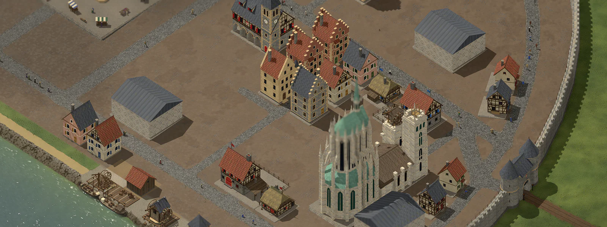
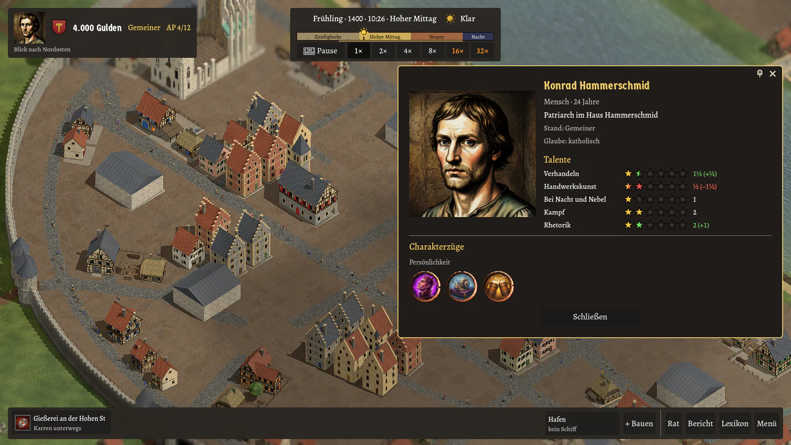

# Reichsgilde

**Wirtschaftssimulation und Dynastie-Sandbox im 2,5D-Stil** – inspiriert von „Die Gilde“ (Europa 1400)

*Ein düster-bodenständiges Heiliges Römisches Reich des Spätmittelalters: Menschen, Zwerge, Elben und Halblinge leben als Bürger in der Stadt, Orks und Oger lauern als Bestien vor den Toren.*

 

*Arbeitstitel · Hobby- und Lernprojekt · Grafikstil: Oberfläche als kolorierter Holzschnitt des Spätmittelalters, die 3D-Welt gemalt-realistisch (im Aufbau, vieles noch aus einfachen Grundformen)*

## Worum es geht

Du führst ein Handwerkerhaus durch Generationen: Du gründest eine Werkstatt, handelst auf dem Markt, heiratest, ziehst Erben heran, steigst vom Gemeinen bis zum Reichsgrafen auf und sitzt im Stadtrat. Gegen dich spielen KI-Häuser nach denselben Regeln, und in den Gassen lauern Banden, Brand und Pest. **Köln am Rhein** mit seinem im Bau befindlichen Dom ist die Stadt, die als Erste für Spieler vorgesehen ist (heute angeboten wird in der Stadtwahl die Probestadt, Köln und die Greybox gibt es als Testkarten mit den Entwickler-Optionen). Die Welt ist ein düster-bodenständiges Heiliges Römisches Reich: Menschen, Zwerge, Elben und Halblinge leben als Bürger in der Stadt, Orks und Oger lauern als Bestien vor den Toren.

*Das Oberhaupt des Hauses: Talente und gemalte Charakterzüge (`--beruf=Schmied --charakter=oberhaupt`).*

## Was das Spiel schon kann

Jede Zeile führt in das passende Kapitel des [Spielbuchs](docs/spielbuch/README.md).

| | Thema | Was schon geht |
|---|---|---|
| 🏰 | [Stadt und Ansicht](docs/spielbuch/stadt-und-ansicht.md) | Drehbare Schrägansicht mit sichtbaren Einwohnern, Tag und Nacht, Wetter von Sonne bis Gewitter, vier Jahreszeiten mit Schnee; Hügel, Flüsse, Brücken, Furten und Fähren; die Karte Köln mit Dom, Rathaus und Rheinhafen. |
| 🚪 | [Gebäude betreten](docs/spielbuch/gebaeude-betreten.md) | Werkstätten aller zehn Berufe, Wohnhaus, Rathaus und Dom von innen – mit Arbeitern, Kunden, Familie, Ratsherren und Gläubigen aus der Simulation. |
| 🏗️ | [Bauen und Leerstand](docs/spielbuch/bauen-und-leerstand.md) | Bauzonen, Wohnhaus und Werkstatt frei bauen, leere Häuser kaufen, sanieren oder abreißen. |
| ⏳ | [Partie und Spieltag](docs/spielbuch/partie-und-spieltag.md) | Ein Spieltag von 4 bis 23 Uhr ist ein Spieljahr; Hauptmenü mit Stadtwahl und Schwierigkeit, Speichern, Aktionspunkte, Zeitstrahl, Betriebsleiste und Meldungen. |
| ⚙️ | [Einstellungen](docs/spielbuch/einstellungen.md) | Grafik-Voreinstellungen von Niedrig bis Ultra, Bildrate, Wettereffekte, Größe der Oberfläche, Farbfilter für Farbsehschwäche. |
| ⚖️ | [Wirtschaft und Handel](docs/spielbuch/wirtschaft-und-handel.md) | Marktpreise nach Angebot und Nachfrage, Betriebe, Karren und Wegbelag, Handel von Hand, Hafen mit fernen Städten und Schiffen, Expansion, Meistergrade, Personalbuch mit Beförderung zum Vorarbeiter, Einrichtung als Talentbaum. |
| ⚒️ | [Berufe](docs/spielbuch/berufe.md) | Zehn Berufe – Schmied, Tischler, Steinmetz, Alchimist, Wirt, Prediger, Dieb, Gardist, Geldleiher, Parfumeur – mit eigenen Waren und Kniffen. |
| 🛡️ | [Haus und Dynastie](docs/spielbuch/haus-und-dynastie.md) | Wappen, Heirat, Kinder, Erbfolge, Talente, gemalte Charakterzüge mit Wirkung in der Wirtschaft, Krankheiten und Pest, Wohnhaus vom Fachwerkhaus bis zum Stadthof. |
| 👑 | [Stand, Rat und Glaube](docs/spielbuch/stand-rat-und-glaube.md) | Vom Gemeinen zum Reichsgrafen, Ämter im Stadtrat, Wahlen, Stadtkasse und Bauvorhaben, katholisch, evangelisch oder Naturglaube. |
| 🗝️ | [Unterwelt und Gericht](docs/spielbuch/unterwelt-und-gericht.md) | Banden, Einbruch, Brand, Erpressung – und dagegen Wächter, Spitzel, Beweise, Anklage und Kerker. |
| 👥 | [Einwohner](docs/spielbuch/einwohner.md) | 25 Einwohner je Haus mit Rolle und Tagesablauf; sie füllen Schänken und Kirchen und kaufen am Markt. |
| 🤖 | [KI-Häuser](docs/spielbuch/ki-haeuser.md) | Rivalen mit Charakter, bis zu acht je Karte, die nach denselben Regeln spielen wie du, ohne Schummelei. |
| 🗺️ | [Kartenwerkstatt](docs/spielbuch/kartenwerkstatt.md) | Level-Editor im Spiel: Gebäude, Wege, Mauern, Gelände, Boden, Wasser und Häfen, Startbelegung, Prüfung nach den Kartenregeln; dazu das Kartenskript `tools/Kartenbau`. |

## Loslegen

**Du brauchst:** [Godot 4.7.x – .NET-Version](https://godotengine.org/download), [.NET SDK 8 oder neuer](https://dotnet.microsoft.com/download), VS Code mit der C#-Erweiterung (empfohlen).

**Spiel starten:** In Godot **Importieren** → `game/project.godot` wählen, dann oben rechts **▶** oder **F5** – das Hauptmenü erscheint. Tests, Export und Plattformen: [docs/ENTWICKLUNG.md](docs/ENTWICKLUNG.md). Startoptionen zum Ausprobieren einzelner Szenen: [docs/STARTOPTIONEN.md](docs/STARTOPTIONEN.md).

Spielstände liegen unter `%APPDATA%\Godot\app_userdata\Reichsgilde\spielstaende` (Windows) bzw. `~/.local/share/godot/app_userdata/Reichsgilde/spielstaende` (Linux).

## Steuerung (Kurzfassung)

- **Leertaste** Pause · **1–4** Tempo · **Mausrad** Zoom · **rechte Maustaste ziehen** oder **WASD/Pfeiltasten** verschieben · **Q/E** drehen
- **Linksklick** auf ein Gebäude öffnet seine Tafel, **Doppelklick** auf Werkstatt, Wohnhaus, Rathaus oder Dom geht hinein
- **F** Familienbuch · **H** Hinterzimmer · **R** Ratskammer · **M** Marktplatz · **B** Bauen · **L** Lexikon · **F1** Hilfe · **F11** Vollbild · **Esc** schließt der Reihe nach Hilfe, Tafel, Gebäude und öffnet dann das Spielmenü

Alle Tasten, Fenster und Tooltips: [Steuerung im Spielbuch](docs/spielbuch/steuerung.md).

## Weiterlesen

| | |
|---|---|
| [Spielbuch](docs/spielbuch/README.md) | Alles, was das Spiel kann, ein Kapitel je Thema |
| [Welt](docs/WELT.md) | Weltgeschichte, Völker, Glaube, Städte |
| [Architektur](docs/ARCHITEKTUR.md) | Wie der Code aufgebaut ist und warum |
| [Entwicklung](docs/ENTWICKLUNG.md) | Projektstruktur, Tests, Export, automatische Prüfung |
| [Startoptionen](docs/STARTOPTIONEN.md) | Alle Optionen zum Ausprobieren und für Bildschirmfotos |
| [Wirtschaftsmodell](docs/WIRTSCHAFTSMODELL.md) · [Leveldesign](docs/LEVELDESIGN.md) | Zahlen und Messungen · Kartenregeln und Städte |
| [Entscheidungen](docs/ENTSCHEIDUNGEN.md) · [Bereichsdateien](docs/bereiche/) | Archiv bis 16.10.2026 · offene Punkte und aktuelle Entscheidungen je Bereich |

**Mitarbeit der Claude-Agenten:** Ein Teamleiter teilt jede Funktion in Aufträge an Mitglieder mit festem Bereich; alle Teile kommen in einem Funktions-Branch und einem PR zusammen, die Protokolle in `docs/` im selben PR. Die Regeln stehen in [CLAUDE.md](CLAUDE.md), die Rollen unter `.claude/agents/`, die Abläufe des Teamleiters in [.claude/teamleiter.md](.claude/teamleiter.md).

## Lizenz

Code: [MIT](LICENSE), auch die Skripte, die Icons und Modelle zeichnen, und die Shader. Inhalte (Grafiken, 3D-Modelle, Icons, Bilder, Sounds und die Texte, die Spieler lesen): was bis zum Merge von PR #240 veröffentlicht ist, steht unter [CC BY 4.0](LICENSE-INHALTE.md) (frei nutzbar, auch kommerziell, mit Namensnennung, nicht widerrufbar); was danach neu entsteht, steht unter „Alle Rechte vorbehalten“ (© B411Y). Einzelheiten und die GitHub-Nutzungsbedingungen in [LICENSE-INHALTE.md](LICENSE-INHALTE.md). Schriften: **Alegreya** (The Alegreya Project Authors) und **Germania One** (John Vargas Beltrán), beide unter der [SIL Open Font License 1.1](game/assets/oberflaeche/schriften/) – die Lizenztexte liegen neben den Schriftdateien. Ausgewählte Modelle der Ordner `natur/` und `props/` (Asset-Kits) stammen von **Quaternius** und stehen unter **CC0 1.0** ([Herkunft](game/assets/modelle/props/HERKUNFT.md)). Dieses Projekt verwendet **keine** Grafiken, Sounds, Texte oder sonstigen Inhalte aus „Die Gilde“ – das Original dient nur als Vorbild für Spielmechaniken.
