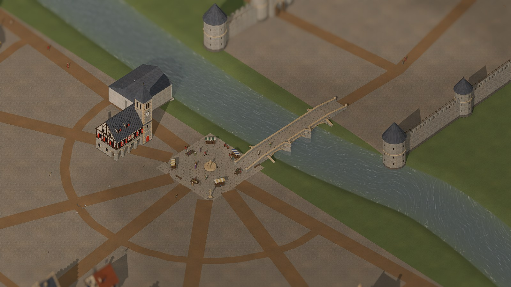

# Stadt und Ansicht

*Reichsstadt in Schrägansicht, Passanten, Tag und Nacht*

Die Reichsstadt ist als begehbare Schrägansicht zu sehen: Mauer (100 × 100 m) mit Ost-, West- und Südtor, vor dem Südtor der Hafen am Grenzfluss, der am Südrand von West nach Ost über die ganze Karte fließt, Wohnhäuser der Spielhäuser am Ring (Fachwerkhaus bis Stadthof, das Stadtpalais aus hellem Haustein mit Erker und zwei Ecktürmchen, der Stadthof mit Haupthaus, Treppenturm, zwei Flügeln und Torhaus, mit Gerüst beim Ausbau, nach Brand rußig, im Leerstand vernagelt), Wohnhäuser der Einwohner am Mauerring (Ratsherren- und Bürgerhäuser nächst dem Markt, mit mehr Spielhäusern eine Vorstadt vor dem Osttor) als Modelle in je drei Varianten und gedeckten Hausfarben, deren Fenster nachts leuchten, Weide, Feld und Holzschläge vor dem Westtor, **Passanten**: die Einwohner laufen sichtbar zu Markt, Gassen, Tor und Umland und verschwinden in Häusern, Schänken, Kirchen und dem Rathaus – bei den Häusern mit Modell, im Dom und im Rathaus erst an der Tür, die Stufen hinauf; man erkennt Volk und Rolle an Gestalt und Tracht, ein Klick zeigt Name, Rolle, Tun und Stimmung. Die Werkstätten der zehn Berufe stehen als Modelle aus Blender da (siehe „Werkstätten als Modelle“); Rathaus (Markthalle mit Ratssaal in Fachwerk und Uhrturm), Dom (gotisch mit Westturm) und Stadtmauer (Mauerstücke mit Zinnen, Mauer- und Ecktürme, Torburgen mit Fallgitter und Stadtwappen) sind ebenfalls Modelle, ebenso der Marktplatz mit Brunnen, Marktkreuz, Bänken und Ständen und die Betriebe vor der Stadt (siehe „Umland und Natur“). Die orthografische Kamera blickt diagonal (nach Nordosten, Nordwesten, Südwesten oder Südosten) und dreht in 90°-Schritten. Der Blickpunkt bleibt im Spielfeld der Karte und wird am Rand weich gebremst (er federt zurück); herauszoomen geht nur so weit, dass das Bild auch am Rand des Spielfelds im Randstreifen bleibt – der Rand hat Felder, Wald und Wege und verblasst nach außen im Dunst, nie sind Himmel oder eine harte Kante zu sehen. Karren fahren sichtbar zum Markt, **Tauben und Spatzen** sitzen in Schwärmen auf den Firsten, fliegen von Haus zu Haus, picken auf Markt, Gassen und Wiesen vor der Stadt, fliegen vor Passanten auf und schlafen nachts auf den Dächern, Licht, Schatten und Himmel folgen der Spieluhr (flüssig, nicht minutenweise), die Glut der Werkstätten leuchtet bei Arbeit, Gebäude lassen sich anklicken.

**Tag und Nacht.** Sonne und Mond wandern über den Himmel und werfen beide Schatten. Der Tag gleitet ohne Sprung in die Nacht: Vor dem Sonnenuntergang färbt sich das Licht zum Abendrot, die Sonne sinkt zum Horizont und blendet dabei aus, danach geht der Mond im Osten auf, und kurz darauf ist richtig Nacht. Morgens ist es umgekehrt: Der Himmel hellt sich auf, der Mond blendet aus, die Sonne geht im Morgenrot auf. Wann das geschieht, richtet sich nach der Jahreszeit und dem Vorbild Köln (51° N); es gilt je Jahreszeit fest für das ganze Spieljahr, einen Übergang zwischen den Jahreszeiten gibt es nicht:

| Jahreszeit (Stichtag) | Dämmerung beginnt | Sonnenaufgang | Sonnenuntergang | dunkel |
|---|---|---|---|---|
| Frühling (Ende März) | 5:15 | 5:55 | 18:05 | 18:45 |
| Sommer (Juni) | 3:00 | 3:50 | 20:10 | 21:00 |
| Herbst (Ende September) | 5:10 | 5:50 | 17:50 | 18:30 |
| Winter (Dezember) | 7:25 | 8:10 | 15:50 | 16:35 |

Der Spieltag beginnt um 4 Uhr: Im Frühling, Herbst und Winter liegt die Stadt dann noch im Mondlicht (so wie um 23 Uhr, wenn die Uhr ins nächste Jahr springt), im Sommer ist die Sonne schon aufgegangen. Im Winter steht die Sonne mittags nur flach und wirft lange Schatten, im Sommer steht sie hoch. Arbeitszeit (8 bis 20 Uhr), Gauner ab 20 Uhr und das Wirtshaus bis 22 Uhr hängen nicht an der Sonne und bleiben, wie sie sind – im Winter wird also vor Arbeitsende dunkel, im Sommer ist es nach Arbeitsende noch hell. Hinter den Fenstern brennt abends Kerzen- und Herdlicht in tiefem Orange, das leise und unregelmäßig flackert, jedes Fenster in seinem eigenen Takt. Mit dem Sonnenuntergang gehen die Lichter nach und nach an (etwa jedes zweite Fenster), bis 23 Uhr wieder aus bis auf wenige; welche, ist je Fenster zufällig und jede Nacht anders. Werkstätten in Betrieb bleiben bis zum Arbeitsende um 20 Uhr hell, Wirtshäuser bis kurz vor 22 Uhr, Wachen die ganze Nacht. Kirchen und Dom bleiben dunkel und leuchten nur, wenn im Dunkeln eine Messe läuft. Essen und Öfen glühen kräftig rot. Springt die Uhr (Jahreswechsel, Laden), blendet das Licht in anderthalb Sekunden über.

**Nachtlichter.** Nach Einbruch der Dunkelheit brennen Lichter in der Stadt – nur Stimmung, ohne Wirkung auf das Spiel. An den Torburgen, am Schilderhäuschen des Wachhauses und am Wachturm stehen Feuerkörbe, an Wirtshaus und Rathaus hängt eine Wandlaterne, am Domportal brennt das Ewige Licht in Rot (bei Tag nur schwach). Die Wachleute auf Streife gehen dann sichtbar eine Runde vom Wachhaus über den Markt zum Tor und zurück und tragen nachts eine Handlaterne; die Runde wechselt mit der Schicht alle zwei Stunden. Wer sonst im Dunkeln draußen unterwegs ist, hat eine Laterne oder (jeder Dritte) eine Fackel in der Hand. Fackeln und Feuerkörbe brennen mit echten, lodernden Flammen mit Funken, in den Laternen brennt ein Flämmchen hinter der durchscheinenden Hornscheibe (siehe „Feuer und Flammen“). Wann sie angehen, sagt die Dämmerung, und die hängt von der Jahreszeit ab: Die Lichter gehen mit dem Sonnenuntergang der Jahreszeit an (Tabelle unter „Tag und Nacht“) und sind zur Dunkelheit alle an; morgens gehen sie mit der Morgendämmerung aus. Fensterlicht, Laternen, Feuer und die Kirchenfenster zur Messe richten sich nach demselben Wert, ebenso der Morgendunst und die Vögel (sie schlafen in der Nacht). Die nächsten Lichter vor der Kamera werfen echten Lichtschein auf Mauern und Pflaster (ohne Schatten; Zahl nach der **Schattenqualität**: Hoch zwölf, Mittel sechs, Niedrig keines, ab Zoom 110 aus); ihr Licht flackert im Takt der Flamme. Jede übrige Flamme leuchtet trotzdem immer: mit einem leichten Hof um die Flamme und einem weichen Schein, der wie ein Licht auf Boden, Stufen und Mauern fällt, auch beim Herauszoomen und in der Stufe Niedrig. Zum Ausprobieren: `--startstunde=21` (Wachhaus: `--beruf=Gardist`, mehr Wachleute mit `--einstellen=Lehrling,Geselle,Geselle,Geselle,Geselle`), im Winter `--startstunde=17 --jahreszeit=winter` (dunkel), im Sommer `--startstunde=20 --jahreszeit=sommer` (noch hell); eine feste Tageszeit für Bilder: `--lichtuhr=3.5 --jahreszeit=sommer` (3:30 Uhr).

**Feuer und Flammen.** Alle Feuer brennen mit Flammen aus einer echten Feuersimulation, die als Bildfolge abgespielt wird, mit Funken, Rauch und flackerndem Licht – auf jeder Grafikstufe gleich (Wahl des Nutzers nach dem Feuertest). Nachts tragen Passanten Fackeln und Laternen, an Torburgen, Schilderhäuschen und Wachturm lodern Feuerkörbe, an Wirtshaus und Rathaus hängen Wandlaternen. Aus den Schornsteinen steigt Rauch: Wohnhäuser heizen im Winter den ganzen Tag, im Frühling und Herbst morgens (5–9 Uhr) und abends (16:30–22 Uhr), im Sommer nur zum Kochen (5:30–7:30 und 18–20 Uhr), jedes Haus etwas früher oder später, und nicht jedes macht mit; Werkstätten rauchen, solange gearbeitet wird, die Schmiede aus ihrer Esse. Nachts ist der Rauch ein mattes Grau im Mondlicht. In den Raumansichten brennen Kerzen (Wirtshaus, Wache, Diebesversteck, Kirche, Geldleihe) und in der Schmiede Flammen über der Esse, solange dort gearbeitet wird oder jemand wach ist. **Brand:** Legen Gauner Feuer – ein Anschlag auf eine Werkstatt oder eine Brandstiftung am Wohnhaus –, brennt das Gebäude sichtbar: Flammen schlagen aus Dach und Fenstern, eine dicke, dunkle Rauchsäule steigt auf, das Feuer leuchtet die Umgebung an. Nach zwei Spielstunden schwelt es nur noch und raucht drei Stunden aus; das Dach bleibt rußig, bis die Reparatur fertig ist (das Wohnhaus steht dann im Gerüst). Zum Ausprobieren: `--startstunde=21` (Nacht), `--startstunde=6` (Kaminrauch), `--brand=werkstatt` oder `--brand=haus` (ein Brand nur zum Ansehen); die Testszene mit allen sieben Feuerarten `--feuertest=1`. Anleitung: [docs/feuer/phase2.md](../feuer/phase2.md).

**Wetter.** Über den Tag wechselt das Wetter alle zwei bis fünf Stunden: klar, wolkig, Regen, Sturm, Gewitter, Schnee und Nebel, sanft ineinander übergehend. Was kommt, hängt von der Jahreszeit ab – Schnee nur im Winter, Gewitter vor allem an Sommernachmittagen, Nebel im Herbst und Frühling und vor allem morgens. Der Ablauf steht fest aus dem Zufallsstartwert der Partie: Nach dem Laden geht das Wetter genau so weiter. Es ist nur zu sehen und ändert nichts an Wirtschaft oder Einwohnern. Wolken dämpfen Sonne und Schatten und färben den Himmel grau, bei Regen fallen Tropfen als Striche unterschiedlicher Länge schräg im Wind und schlagen am Boden kleine Ringe und Spritzer, bei Schnee Flocken (um den Blickpunkt, bei jedem Zoom gleich groß im Bild), der Boden wird nach und nach nass, dunkel und glänzend, in Mulden, auf Wegen und in den Gassen stehen Pfützen in nassem Lehmbraun mit dunklem Rand und einem Schimmer vom Himmel (darin ziehen die Tropfen Ringe), die Dächer werden bei Regen dunkler und etwas glatter (Ziegel, Schiefer, Schindeln und Stroh, auch die steilen Turmhelme; fließendes Wasser sieht man nur als sehr feine, langsam bergab ziehende Schimmerbänder), die Mauern und das Fachwerk werden bei Regen langsam dunkler und glänzender (mit einzelnen, deutlichen Laufspuren unter Simsen und Fenstern) und trocknen danach wieder ab, an den Traufen und an den Giebelkanten tropft es (nahe der Kamera, an den Giebeln deutlich weniger), und wo das Dachwasser aufschlägt, zieht sich ein unregelmäßiger nasser Streifen am Boden entlang (Erde und Lehm satt dunkelbraun und matschig glänzend, Pflaster dunkelgrau-nass, im Gras kaum etwas), mit kleinen Pfützen, in denen es spritzt und feine Ringe laufen; er bleibt nach dem Regen etwas länger nass als der übrige Boden (Tropfen und nasse Kante blenden beim Herauszoomen aus), und die Ringe der Regentropfen behalten ihre Größe in der Welt und blenden beim Herauszoomen aus, und nach dem Regen trocknet alles in etwa einer Stunde ab. Trocken liegen keine dunklen Wasserflecken mehr im Lehm. Bei Gewitter erhellen Blitze kurz die ganze Stadt, bei Sturm biegen sich Gras und Baumkronen, die Fahnen schlagen und die Wolkenschatten jagen über die Felder; Nebel legt sich kühlgrau über die Ferne, die Stadt bleibt klar erkennbar und Boden wie Häuser verblassen im selben Ton. Oben links unter der Uhrzeit zeigt ein **Wettersymbol** das Wetter, daneben klein die nächsten Abschnitte des Tages mit ihrer Uhrzeit; der Tooltip nennt die Aussicht in Worten. Wie viel davon zu sehen ist, stellt die Einstellung **Wettereffekte** ein.

**Nebel.** Nach einer klaren, windstillen Nacht liegt morgens oft Nebel – nicht jeden Tag: im Herbst an drei von vier solchen Morgen und am dichtesten, im Frühling und Winter an knapp jedem zweiten, im Sommer seltener, dünner und schnell verflogen; nach einer wolkigen Nacht nur dünn, nach Wind oder Regen nie. Er sammelt sich über dem Wasser (über dem Rhein am dichtesten, an einem Bach nur ein Hauch), in Senken und über Wiesen, in der Stadt nur wenig, und liegt in Fetzen mit Lücken, die langsam mit dem Wind ziehen – den Fluss sieht man von oben meist durch ihn hindurch. Am dichtesten ist er um den Sonnenaufgang; danach löst er sich von den Rändern her auf: an Land im Sommer in knapp zwei Stunden, im Frühling in gut zwei, im Herbst und Winter in drei, über dem Wasser eine gute halbe Stunde später. Kommt Wind auf oder fängt es an zu regnen, verfliegt er schneller. Abends nach Sonnenuntergang steigen erste Fetzen über dem Wasser auf, und in der Nacht wächst der Nebel weiter – dunkel wie die Nacht, im Mondlicht etwas heller, im Schatten der Häuser nicht, und um Laternen und Feuer mit einem leichten Lichthof. Die Wetterlage „Nebel“ ist etwas anderes: Dann liegt er den ganzen Tag dicht. Zu sehen ist der Nebel mit der Einstellung **Morgendunst** Niedrig oder Hoch (ab der Grafikstufe Hoch). Ausprobieren: `--jahreszeit=herbst --wetter=klar --morgennebel=1 --lichtuhr=6.5`; nachts `--lichtuhr=23` (zum Vergleich ohne Nachtnebel `--nachtnebel=aus`).

**Jahreszeiten.** Jedes Spieljahr hat eine Jahreszeit (Frühling 1400, Sommer 1401, Herbst 1402, Winter 1403 …), und die Stadt sieht danach aus: Im Frühling ist die Wiese frisch und hell, das Laub jung, auf den Äckern steht grüne Saat; im Sommer ist alles satt und die Frucht reif; im Herbst wird die Wiese gelblich-braun, das Laub bunt, die Äcker sind abgeerntet und zeigen Stoppeln; im Winter liegt Schnee auf Wiesen, Äckern und Dächern, die Laubbäume stehen kahl, die Äcker liegen brach. Auf den Wegen ist der Schnee ausgetreten und zu Matsch geworden, in der Stadt zertreten und grau. Am Abend des Winters taut der Schnee mit dem Eisgang weg, der Frühling beginnt ohne Schnee. Beim Jahreswechsel gleitet das Bild in Sekunden über. Zum Ausprobieren (nur Darstellung, nur für diesen Start): `--wetter=<klar|wolkig|regen|sturm|gewitter|schnee|nebel>`, `--jahreszeit=<fruehling|sommer|herbst|winter>`, `--wetter=gewitter --blitz=1` (ein Blitz bleibt stehen).

**Wasser.** Flüsse, Bäche, Teiche, Seen und Hafenbecken sind gemalt-realistisches Wasser: Es fließt sichtbar in Laufrichtung (auch durch die Kurven), spiegelt den Himmel, zeigt im Flachen den Grund mit hellen Lichtnetzen und wird zur Tiefe hin dunkel. Was für ein Gewässer es ist, sagt seine Größe in der Karte: Ein Lauf bis 5 m Breite ist ein Bach, ein breiterer ein Fluss; eine Fläche bis 2.000 m² ein Teich, eine größere ein See. **Uferschaum** – ein weicher, zerrissener Saum an Ufer, Pfeilern und Steinen – haben nur Flüsse ab 30 m Breite (in Köln der Rhein); wo der Fluss an einem Hafen vorbeiströmt, bleibt nur ein schmaler Saum, im Hafenbecken selbst liegt das Wasser still und ohne Schaum. **Wind und Regen:** Bei Sturm werden die Wellen höher und unruhiger – sie bauen sich über eine halbe bis ganze Minute auf und klingen langsamer ab –, bei Regen laufen sofort Ringe über das Wasser (wie die Pfützen nur in den Wettereffekten Hoch). **Eis:** Im Winter friert stilles Wasser zuerst – Teiche bis 2.000 m², Hafenbecken und Gräben sind schon nach knapp einem Fünftel des Winters ganz zu (weiß-blau, mit Rissen und Schnee darauf). Bäche bis 5 m Breite frieren später vom Ufer her ganz zu (nach drei Fünfteln des Winters); offen bleibt nur ein kleines Loch an ihrer Mündung und an schnellen, steilen Stellen. An einer **Furt** wächst nur Randeis vom Ufer her, die Mitte bleibt offen. Breite Flüsse wie der Rhein bekommen nie eine Decke, nur Randeis am Ufer (5 % der Breite, höchstens 5 m; es besteht wie in echt aus festgefrorenen Schollen und Eisbrei) und **treibende Eisschollen**, die mit der Strömung ziehen (in der Mitte schneller als am Ufer, große träger als kleine), sich kaum drehen und sich beim Zusammenstoßen aneinanderlegen statt abzuprallen. Vor einer Brücke stauen sie sich zwischen den Pfeilern zu einem Bogen; er hält eine Weile und löst sich, wenn eine Scholle am Eisbrecher **bricht** (mit einer Chance: große eher als kleine, morsches Eis leichter, die Stücke passen genau aneinander und gleiten links und rechts am Pfeiler vorbei) oder unter das Eis gedrückt wird; an der Staukante tauchen schnell ankommende Schollen auch unter dem Stau durch. Wo sich zwei Schollen im Gedränge überdecken, liegt die dünnere schräg auf der anderen (aufgeschoben), kleine Brocken werden unter große gedrückt. Die Fähre hält sich eine Rinne durch das Randeis frei. Festes Eis ist starr, nur das offene Wasser davor bewegt sich. Größere Seen bekommen einen Eisrand von 3 bis 6 m. Vor jeder Eiskante liegt ein grauer Saum Grieseis, und das offene Wasser ist im Winter dunkler und kälter. Eis gibt es nur im Winter: Es wächst über gut die Hälfte des Winters und hält; am Abend des Winters kommt der **Eisgang** – die Decken von Bach, Teich und Hafen brechen in Platten auf, auf dem Rhein treiben erst mehr Schollen, dann **schmelzen** sie: Sie werden kleiner, runder, dünner (liegen tiefer im Wasser), grau und nass, kleine sinken ab und vergehen, so wird der Fluss nach und nach frei; am Ende schmilzt alles, mit dem Schnee. Das Schmelzen hält mit dem Spieltempo Schritt: Bei schnellem Tempo geht der Eisgang schneller, die letzten Schollen treiben aber noch aus, statt auf einen Schlag zu verschwinden. Schon im Hochwinter werden Schollen, die oft aneinanderstoßen, an den Ecken etwas runder und am Rand nasser. Der Frühling beginnt ohne Eis und Schnee. Nur Darstellung: Das Eis ändert nichts an Wegen, Fähren und Handel. Wie aufwendig das Wasser gezeichnet wird, folgt der Voreinstellung (siehe „Einstellungen“). Zum Ausprobieren: `--jahreszeit=winter --winter=0.4` (Eis zu 40 % gewachsen), `--tauwetter=0.5` (mitten im Eisgang), `--schollenbruch=10` (Schollen brechen viel öfter, zum Ansehen), `--wetter=sturm`, `--wasserstufe=niedrig`, dazu `--freiekamera=1`, um frei bis ans Wasser zu fliegen (siehe „Steuerung“).

**Passanten und Markt.** Die Einwohner sind Figuren mit Skelett, je Volk ein eigenes Modell (Mensch, Zwerg mit Bart, Elb, Halbling), Männer und Frauen (Frauen etwas kleiner), mit der Tracht ihrer Rolle (Strohhut, Barett, Kapuze, Haube, Schleier, Schürze, Kiepe, Bündel, Tasche, Stab). Sie bewegen sich nach dem, was sie tun: Sie gehen, eilen, schleppen ihre Last, Bettler und Alte gehen gebeugt – im Takt ihres Tempos, sodass die Füße nicht rutschen. Auf dem Feld hacken sie, im Wald heben sie Holz auf, auf der Weide hüten sie. Der Marktplatz liegt auf demselben Kopfsteinpflaster wie die Gassen (der Boden der Karte, ohne eigene Platte im Modell), bei Regen nass, im Winter unter Schnee. Auf dem Marktplatz stehen sie als Kunden an den Ständen, plaudern in kleinen Runden, holen Wasser am Brunnen, sitzen auf den Bänken oder schlendern den Rundgang entlang; im Dom sitzen sie auf den Bänken. Jeder Stand legt die Waren eines Handwerks aus (Eisenwaren, Holzwaren, Steinwaren, Tinkturen, Bier und Brot, Kerzen und Bücher, Düfte, Rohstoffe): zuerst die, die Spieler und KI-Häuser gerade auf den Markt gebracht haben, die übrigen Stände füllt die Grundversorgung der Stadt – von der Arbeitszeit des ersten Tages an sind die Stände also voll (sieben Stände, acht Warengruppen: die kleinste fehlt). Dahinter steht zur Arbeitszeit ein Verkäufer. Wer zum Markt geht, betritt den Platz am Rand, wo seine Gasse auf das Pflaster trifft, und geht von dort direkt zu seiner Stelle; Brunnen, Marktkreuz, Bänke und Stände umgeht er, ebenso wer nur über den Platz hindurch will (`--wegenetz=1` zeigt die Gassen, die auf den Platz zulaufen). Figuren außerhalb des Bildes werden nicht bewegt, ganz herausgezoomt seltener – das spart Rechenzeit. Ausprobieren: `--blick=2,4,25 --ui=0` (Markt nah), `--innen=Dom` zur Messe um 10 Uhr.

**KI-Schmied.** In der Schmiede arbeitet kein Blender-Mensch mehr, sondern ein Schmied, der mit KI aus einem Bild entstand (TRELLIS.2, 20.000 Dreiecke, 52 Knochen, Gehen-Animation von Kimodo). In der Stadt tragen ihn Knechte und Tagelöhner (jeder zweite Mann dieser Rollen), im Takt ihres Tempos, sodass die Füße nicht rutschen. Anschauen: `--beruf=Schmied --innen=1` oder `--blick=0,0,25 --kischmied=alle`; `--kischmied=aus` schaltet ihn ab. Er steht mit einer Atem-Animation herum und hämmert bei der Arbeit am Amboss (Schlag und Hammer selbst auf dem Skelett gebaut).

**Schatten.** Schatten setzen genau am Fuß an – bei Passanten, Marktständen, Masten und Fahnen; das flatternde Tuch wirft einen flatternden Schatten. Wie fein sie sind, stellt die **Schattenqualität** in den Einstellungen ein.

**Bloom.** Lichtquellen leuchten weich nach: das Licht hinter den Fenstern bei Nacht, die Glut der Werkstätten, die Domfenster und das Fensterglas der Raumansicht. Sonnenbeschienene Dächer und Wände bleiben klar, es schimmert nichts bei Tag. In den Einstellungen lässt sich der Bloom ausschalten und seine Stärke regeln (50 % ist das empfohlene Bild, 100 % deutlich kräftiger). Zum Ausprobieren: `--startstunde=21 --bloomstaerke=100` oder `--bloom=Aus`.

**Umgebungsverdeckung und indirektes Licht.** Ecken, Fugen und Fußpunkte werden ein wenig dunkler: Häuser, Marktstände und Mauern stehen fester auf dem Boden, in der Raumansicht werden Raumecken und Möbelfüße betont. Es bleibt dezent – kein grauer Schleier über Flächen. Die Stufen Niedrig, Mittel und Hoch unterscheiden sich in Feinheit und Rechenaufwand. Das **indirekte Licht (SSIL)** lässt Flächen etwas Farbe auf ihre Nachbarn zurückstrahlen, ist zurückhaltend abgestimmt und standardmäßig aus. Zum Ausprobieren: `--ssao=Hoch` oder `--ssao=Aus`, `--ssil=An`.

**FSR 2.2 (Hochskalierung).** Mit FSR rechnet das Spiel das 3D-Bild in kleinerer Auflösung (Regler „Renderauflösung“, 67 % entspricht AMDs Stufe „Qualität“) und holt es aus den letzten Bildern auf volle Größe zurück. Das spart Grafikleistung, bei schwächeren Karten sind damit höhere Einstellungen bei Schatten und Verdeckung möglich. FSR glättet die Kanten selbst, darum ruht die Kantenglättung der Einstellungen, solange es an ist, und gilt danach wieder. Beschriftungen in der Stadt werden bei sehr niedriger Auflösung unscharf, bewegte Fahnen können leicht krümeln. Zum Ausprobieren: `--fsr=An --renderaufloesung=50`.

**Oberflächendetails.** Die Modelle behalten ihre Farben und bekommen eine feine Struktur je Material: Mauern zeigen Quader mit leichten Farbunterschieden und weichen Fugen, Mauerkronen und Gassen Kopfsteinpflaster, Balken und Bretter Maserung mit Ästen, Dächer einzelne Ziegel oder Schieferplatten mit etwas Abnutzung und Stroh seine Halme, Bäume Blätter, Wiesen und Wege Körnung und große, unregelmäßige Flecken; dazu eine leichte Unebenheit im Licht. Das gilt in der Stadt, im Umland und in den Innenräumen, auch für Neubauten, neue Karren und Figuren, für die Farben der Besitzer und die Jahreszeiten. Glut, Fensterlicht, Glas und Wasser behalten ihr Aussehen; wo ein Modell Steine oder Dielen schon als Form hat, kommt keine zweite Struktur dazu. Die Details sind immer an (auf der Testkarte NVIDIA T400 kosten sie etwa 6 % der Bilder je Sekunde, die Zahl der Zeichenaufrufe bleibt gleich). Das Mauerwerk zeichnen allein sie: Die Modelle haben keine aufgemalten Fugenlinien mehr.

**Modell-Texturen** (Gruppe 1: Stadthäuser und Mauer). Bruchstein, Quadermauerwerk, Kalk- und Lehmputz, Fachwerkholz, Bretter, Biberschwanz-Ziegel, Schiefer, Stroh, Sandstein und Backstein kommen aus einer Material-Bibliothek: in Blender modellierte und gebackene Texturen mit einzelnen Steinen und Mörtelfugen, Kellenschlag und Schwundrissen im Putz, Maserung, Rissen und Ästen im Holz, Brettfugen mit Nägeln, Flechten auf Ziegeln und Schiefer, Halmen im Stroh, Laufspuren und Flecken. Jedes Haus behält dabei seine Farbe (die Textur färbt sich nach der Modellfarbe, im Mittel genauso hell), Wände zeigen durchlaufende Lagen auch um Ecken und Türme, Ziegel und Schiefer laufen die Dachfläche hinauf. Die Stufe folgt der Einstellung „Boden“: *Niedrig* die feine Struktur wie bisher, *Mittel* die Farben der Bibliothek, *Hoch* dazu Unebenheit und Glanz im Licht. Die Bibliothek gilt für alle Modelle mit diesen Materialien. Vorschau der Materialien: `docs/bilder/materialien/`. **Gruppe 2** (Kirche, Rathaus, Wachturm, Werkstätten) bringt geschmiedetes Eisen mit Hammerschlag und Rost (Beschläge, Gitter, Firstbleche), Kupferblech mit Falzen und Patina (Dachreiter und bunte Turmspitzen), Holzschindeln (Diebesnest), Leder, grobes Leinen (Lumpen, Tuch) und gestrichene Bretter für alles in der Hausfarbe und den Stadtfarben (Läden, Türen, Tore, Wappen – die Farbe des Hauses bleibt, nur stellenweise blättert sie ab). Turmhelme, Pultdächer und andere Dächer ohne gebaute Ziegelreihen zeigen jetzt Reihen mit versetzten Fugen statt durchgehender Streifen, und die aufgesetzten Bretterleisten (Diebesnest, Pultdächer) sind weg – die Bretter zeichnet die Textur. Der Wachturm bekommt die Bibliothek je Fläche, obwohl seine Farben in einem Material zusammengelegt sind. **Gruppe 3** (Umland, Natur, Wasserbauten) bringt Borke mit Furchen und Flechten (Stämme, Äste, Stümpfe), gewachsenen Fels (Felsberg, Brocken, Steine am Ufer), waagerechte Planken mit Pechfugen und Holznägeln (Rümpfe von Schiff, Kähnen und Fähre, Blockhütten), Laub in Büscheln mit Licht und Schatten und hängende Nadelzweige für die Tannen; Laub färbt sich weiter mit der Jahreszeit. Die Hütten und Betriebe des Umlands, Hafen, Brücken, Fähre und Hafenbauten tragen die Bibliothek je Fläche, die aufgesetzten Bretter- und Stammfugen der Hütten und Rümpfe sind weg.

**Fahnen im Wind.** Alle Fahnen der Stadt flattern: auf den Wohnhäusern, am Wachturm, am Schilderhäuschen der Wache und auf den Werkstätten. Das Tuch hängt am Mast fest und schlägt am freien Ende am stärksten aus; Falten fangen Licht und Schatten. Jede Fahne flattert in ihrem eigenen Takt. Die Grafikkarte rechnet das mit einem kleinen Programm (Shader), der Wind ist für alle gleich; bei Sturm schlagen sie heftiger (siehe „Wetter“). In den Einstellungen (Reiter Stimmung) lassen sich die Fahnen anhalten.

**Verkaufte Werkstätten.** Wer eine Werkstatt verkauft, lässt das Haus stehen: in seiner Stufe, aber ohne Wappen und Fahne, Tor und Fenster vernagelt, die Scheiben dunkel, davor das ockerfarbene Schild „zu verkaufen“. Ein Klick darauf bietet es zum Kauf an; betreten lässt es sich erst wieder nach dem Kauf. Eine gekündigte Pacht wird wieder leere Grube bzw. freier Umlandplatz mit grünem Schild.

**Werkstätten als Modelle.** Die zehn Werkstätten der Stadt (Schmied, Tischler, Steinmetz, Alchimist, Wirt, Prediger, Dieb, Gardist, Geldleiher, Parfumeur) stehen als Modelle aus Blender da, nicht mehr als Quader: Jede Stufe zeigt ihren Ausbau (zum Beispiel Gießerei, Schmiede, Goldschmiede), beim Umbau steht ein Gerüst davor, Tür, Fensterläden, Wappen und Fahne tragen die Farbe des Hauses. Wird gearbeitet, **glüht** die Esse, der Ofen oder der Athanor der Werkstatt, sonst nicht. **Bei Nacht brennt Licht in den Fenstern** (ab 18 Uhr nach und nach heller, ab halb sechs morgens verlöschend), in leeren und verkauften Häusern bleibt es dunkel. Karren halten am Halteplatz vor dem Tor des Modells. Die Modelle sind 16 × 14 m groß, und so groß sind auch ihre Plätze in der Stadt: Keine Werkstatt stößt an ein Nachbarhaus, jede hat ihren Vorplatz mit einer Gasse zum Markt.

**Umland und Natur.** Die acht Umlandbetriebe stehen als Modelle da: Grube mit Felshang, Stollen, Gleis und Förderwagen (dahinter ein großer Felsberg mit Gras und Tannen, so gestellt, dass er Wegen und Nachbarn nicht in die Quere kommt), Holzschlag mit Blockhütte und Polter, Steinbruch mit abgetreppter Bruchwand und Dreibein, Kräutergarten mit Beeten und Krötenteich, Duftgarten mit Lavendel und Laubengang, Bauernhof mit Fachwerkscheune und Bockwindmühle, Klosterhof mit Zellenhaus, Beeten und Wegkreuz, Wachturm mit Zinnen und Palisade. Jeder dreht seine Vorderseite zur Straße; dort endet der Weg, und die Karren halten. Die Fahne trägt die Farbe des Besitzers, die Glut der Grubenlampe und des Feuerkorbs leuchtet bei Arbeit (der Feuerkorb des Wachturms auch nachts, solange ein Gardist Wache hält). Ein freier Platz zeigt dasselbe Haus verlassen, mit Brettern und Unkraut und dem Schild „zu verpachten“. Weide, Feld und Wald der Einwohner vor dem Westtor sind ebenfalls Modelle. Der Wald um die Stadt besteht aus Tannen, im Westen auch Eichen und Buchen, dazwischen liegen locker Gruppen aus Büschen, Wiesenblumen, Steinen und Totholz, am Bach beim Kräutergarten stehen Kopfweiden mit Schilf; alles steht bei jedem Start an derselben Stelle. Das Laub folgt der Jahreszeit: Im Frühling ist es heller und frischer, im Herbst werden die Blätter gelb, orange und braun. Im Winter stehen Eichen, Buchen, Linden, Kopfweiden und die Laubbüsche kahl da (Tannen, Ginster und Wacholder bleiben grün), die Linden an Wirt, Prediger, Geldleiher, Kräutergarten und Klosterhof zeigen ihre Äste, und das übrige Laub (Hecken, Beete, Weide) verdorrt zu Stroh und Braun; im Frühling kommt das Grün zurück. Zum Ausprobieren: `--spulen=2040` lässt zwei Spieljahre ablaufen, dann ist Herbst, `--spulen=3060` drei, dann ist Winter.

**Karren als Modelle.** Hand-, Ochsen- und Kriegskarren fahren als Modelle mit Zugtieren durch die Stadt: Der Handkarren hat zwei Holme, der Ochsenkarren große Speichenräder und ein Joch, der Kriegskarren ist ein Wehrwagen mit hohen Bohlenwänden und zwei Pferden. Beim **Fahren** drehen sich die Räder genau so schnell, wie der Karren rollt (bei hohem Tempo ruhen sie lieber, als zu flimmern), die Tiere gehen und der Wagen wippt; am Hof **stehen** die Karren, die Tiere nicken und schlagen mit dem Schwanz. Wie viele Sorten Ware geladen sind, zeigen Kisten, Säcke und Fässer (ein Handkarren trägt eine Sorte, ein Ochsenkarren zwei, ein Kriegskarren drei), darüber liegt eine **Plane in der Farbe des Besitzers**. Ein **Mensch** geht am Karren mit: ein Knecht zieht den Handkarren zwischen den Holmen, ein Treiber führt den Ochsen, ein Kutscher sitzt auf dem Bock des Kriegskarrens; sie gehen im Takt der Räder und stehen, wenn der Karren hält. Am Markt halten die Karren am Rand des Platzes und wenden, statt im Brunnen zu stehen. Karren außerhalb des Bildes werden nicht animiert. Zum Ausprobieren kauft `--karren=Ochsenkarren,Kriegskarren` (mit `--vermoegen=9000`) der eigenen Werkstatt gleich Karren dazu.

**Gelände.** Karten dürfen Hügel haben (Höhenraster alle 2 m, von −20 bis +60 m; die Probestadt hat welche im Randstreifen und einen sanften Hang an der östlichen Vorstadt). Der Boden besteht dann aus Kacheln zu 128 m, weit vom Spielfeld mit gröberem Netz (jeder zweite Punkt); eine flache Karte ohne Wege bleibt eine einzige Ebene und kostet nichts (mit Wegen bekommt auch sie Kacheln, in die die Wege eingearbeitet sind). Alles steht auf dem Boden: Wege und Mauern liegen in ihrem eingeebneten Bett (Mauerstücke neigen sich mit dem Hang), Bäume, Büsche und Äcker folgen der Höhe, Passanten gehen und Karren fahren auf dem Boden (Karren nicken mit dem Gefälle und fahren bergauf langsamer, wie der Kern sie bremst), und der Blickpunkt der Kamera steigt und fällt weich mit dem Boden unter ihm. Ein Gebäude steht auf dem **höchsten Punkt** unter seiner Fläche; darunter wächst bis zum Boden ein **Sockel aus Bruchstein** mit gepflasterter Oberseite – das Gelände selbst bleibt, wie es ist. Der Dunst am Rand schmiegt sich an die Hügel. Ein Klick auf den Boden trifft das Gelände, nicht eine Ebene.

**Köln.** Die zweite Karte zum Spielen und die erste Stadt für Spieler: `--karte=koeln`. Der Rhein (60–100 m breit) fließt nach Norden, am linken Ufer Rheingasse, Hafen mit Kran, Zoll und Stapelhaus, darüber die Altstadt auf einer Terrasse mit Hochufer, ein Halbkreis aus Mauer mit fünf Toren (Eigelstein, Ehren, Hahnen, Weyer, Severin) und zwei Ufertoren. Innen der Heumarkt, Rathaus, fünf Kirchen (noch als Blöcke), der Dom im Norden, Hohe Straße, Schildergasse, Breite Straße, Severinstraße und die Wallstraßen; der Duffesbach läuft durch die Südstadt. Auf dem rechten Ufer liegt Deutz mit eigener kleiner Mauer, über die (erfundene) Rheinbrücke und die Fähre Mülheim zu erreichen. Acht Startgrundstücke rund um die Märkte (du und bis zu sieben KI-Häuser), im Umland Betriebe an den Landstraßen, im Rand Kölner Bucht, Ville, Königsforst und Bergisches Land. Gebaut ist die Karte per Kartenskript (`tools/Kartenbau/Staedte/Koeln.cs`), verfeinert wird sie in der Kartenwerkstatt (`--kartenwerkstatt=koeln`).

[Zurück zum Inhaltsverzeichnis](README.md)
