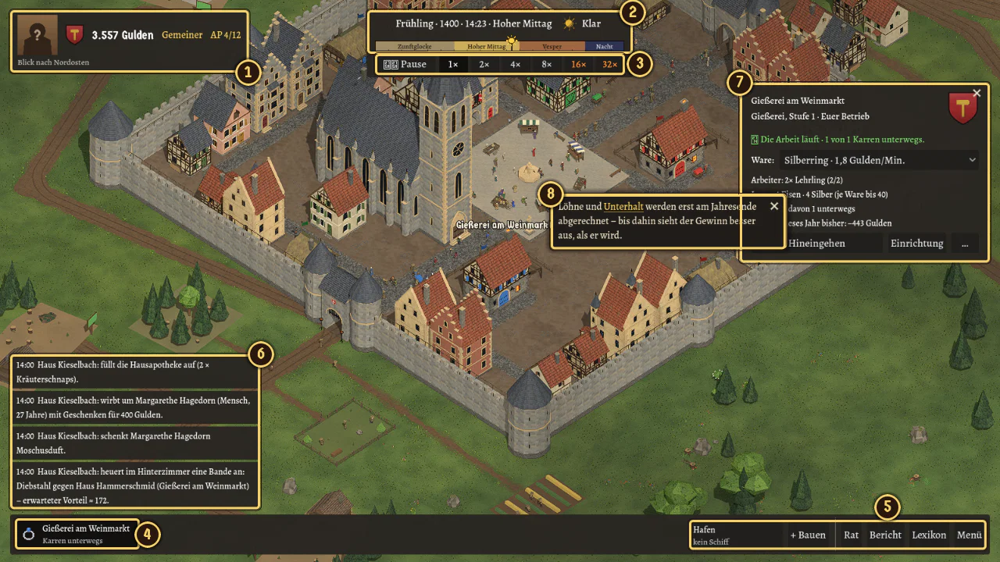
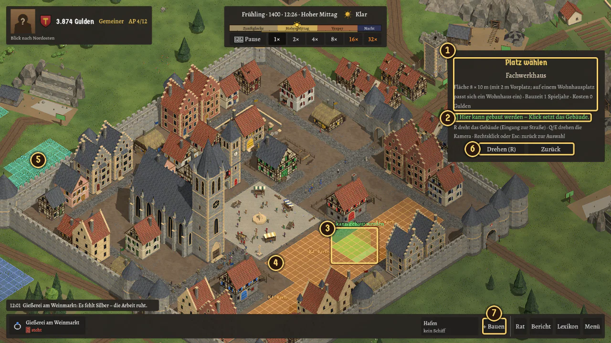
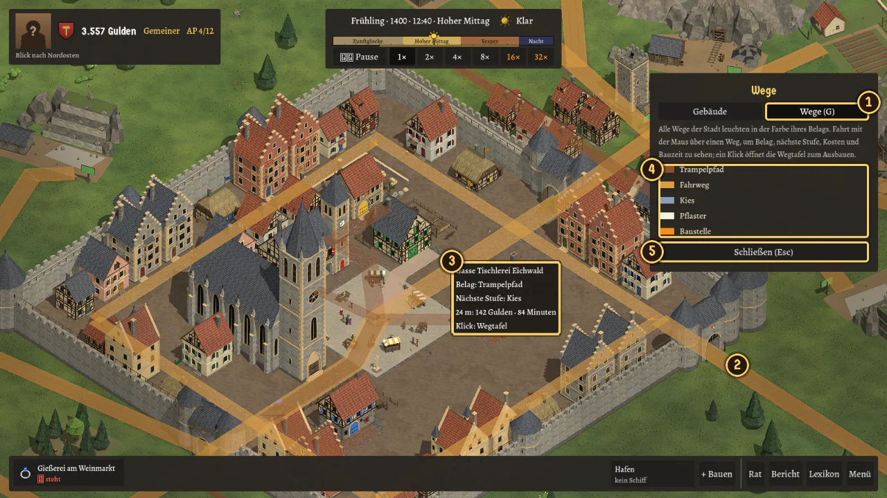
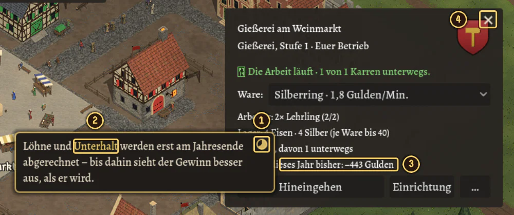

# Steuerung

*Tasten, Maus, Fenster und Tooltips*

Dieses Kapitel zeigt, wie du durch die Stadt kommst, Gebäude öffnest, baust und mit den Fenstern umgehst. Wer nur schnell etwas nachschlagen will, springt zur [Tastenübersicht](#tastenübersicht).

## Erste Schritte

1. **Leertaste** hält die Zeit an und lässt sie weiterlaufen.
2. Mit dem **Mausrad** zoomst du, mit der **rechten Maustaste gezogen** schiebst du die Stadt zurecht.
3. Ein **Klick** auf ein Gebäude zeigt seine Tafel, ein **Doppelklick** auf deine Werkstatt führt dich hinein.
4. **Esc** geht immer einen Schritt zurück, zuletzt ins Spielmenü mit Speichern, Laden und Einstellungen.
5. **F1** zeigt die Tastenhilfe. Beim allerersten Spiel erscheint sie einmal von selbst.

> [!TIP]
> Die Zeit läuft auch weiter, während eine Tafel offen ist. Drück vor einer größeren Entscheidung die **Leertaste**: In der Pause kannst du in Ruhe lesen und rechnen.

## Der Bildschirm

| Nr. | Was | Wozu |
|---|---|---|
| **1** | **Dein Haus** (Kopfzeile) | Wappen, Geld, Stand und Aktionspunkte (AP, hier 4 von 12). Darunter steht, wohin die Kamera blickt. Ein Klick öffnet das **Wohnhaus** mit Stand, Familie, Handwerk, Geld und Hinterzimmer. |
| **2** | **Zeitstrahl** | Jahreszeit, Jahr, Uhrzeit und Tageszeit, dazu das Wetter mit Aussicht. Das Band darunter zeigt den Spieltag von 4 bis 23 Uhr (Zunftglocke, Hoher Mittag, Vesper, Nacht); die Sonne wandert darauf, nachts der Mond. Wann das Band dunkel wird und der Mond erscheint, richtet sich nach den Sonnenzeiten der Jahreszeit (Tabelle im Kapitel „Stadt und Ansicht“, der Tooltip nennt sie). |
| **3** | **Pause und Tempo** | Pause (Leertaste) und Tempo 1×, 2×, 4× und 8× (Tasten **1** bis **4**). |
| **4** | **Betriebsleiste** | Ein Knopf je eigenem Betrieb mit seinem Zustand („läuft“, „steht“, „Karren unterwegs“). Ein **Klick** fährt hin und zeigt die Kurzübersicht, ein **Doppelklick** geht hinein. Bei vielen Betrieben rollt die Leiste. |
| **5** | **Knöpfe rechts** | **Hafen** (nur auf Karten mit Schiffshandel), **+ Bauen**, **Rat**, **Bericht**, **Lexikon** und **Menü**. |
| **6** | **Meldungen** | Die letzten vier Ereignisse mit Uhrzeit. Sie verblassen nach 20 Sekunden; Warnungen (✗ ein Befehl ging nicht, ⚠ Gefahr) bleiben, bis du sie anklickst. Ein Klick öffnet das **Protokoll des Jahres** mit allen Meldungen. |
| **7** | **Tafel rechts** | Erscheint nur, wenn du etwas anklickst, hier die Kurzübersicht der Gießerei. |
| **8** | **Tooltip** | Ein Hinweistext, wenn die Maus auf einer Zeile ruht; hier ist er festgeheftet (✕). Mehr unter [Fenster und Tooltips](#fenster-und-tooltips). |

> [!NOTE]
> Die Tempostufen **16×** und **32×** (orange, Tasten **5** und **6**) sind nur zum Testen gedacht und fallen vor der Veröffentlichung weg.

## Kamera

| Du willst … | So geht es |
|---|---|
| näher heran oder weiter weg | **Mausrad** |
| die Stadt verschieben | **rechte Maustaste halten und ziehen**, oder **W A S D**, oder die **Pfeiltasten** |
| um die Stadt herum schauen | **Q** und **E** drehen die Kamera in Vierteln (90°); in der Kopfzeile steht, wohin du blickst |
| alle Namen sehen | **Alt** gedrückt halten |

Der Name eines Gebäudes steht über ihm, wenn die Maus darauf ruht oder wenn es ausgewählt ist. Am Rand der Karte bremst die Kamera von selbst.

Freie Plätze tragen ein Schild am Pfosten: **ocker** heißt **zu verkaufen**, **grün** **zu verpachten** (mehr dazu in [Bauen und Leerstand](bauen-und-leerstand.md)).

## Gebäude anklicken und betreten

- **Linksklick** auf ein Gebäude öffnet seine Tafel neben dem Zeiger; sie lässt sich verschieben und schließen. Bei deinem **Betrieb** ist es die Kurzübersicht, beim eigenen **Wohnhaus** das Wohnhaus mit Reitern, beim **Rathaus** der Rat mit Ämtern, Statut und Gericht, beim **Marktplatz** der Markt mit den Preisen. Hafen, Kran, Schuppen und eigene Schiffe öffnen die Hafentafel.
- **Doppelklick** auf eine Werkstatt, das Wohnhaus, das Rathaus oder den Dom geht **hinein**. In der Betriebsleiste gilt dasselbe: Klick = hinfahren und Kurzübersicht, Doppelklick = hinein.
- **Drinnen** wechselst du den Raum mit der **Raumleiste** (unten rechts) oder mit **Q** und **E**. Ein **Klick** auf einen Gegenstand öffnet seine Tafel (Produktion, Personal, Lager, Karren, Einrichtung …), ein Klick auf eine Tür wechselt den Raum. **Rechtsklick** oder **Esc** führt wieder hinaus. Die Ansicht im Raum ist fest: Zoomen und Verschieben gibt es nur draußen.
- In Räumen mit mehreren Blickpunkten schwenkst du, indem du die **Maus kurz an den Bildrand** hältst; goldene Pfeile zeigen, wohin es noch geht. Mehrere Arbeiter wählst du mit einem **Rahmen** (linke Taste auf freier Fläche ziehen) oder mit **Umschalt** bzw. **Strg** beim Anklicken.
- Ein Klick auf ein **Porträt** (zum Beispiel im Familienbuch, im Rat oder bei den Rivalen im Bericht) öffnet das **Charakterfenster**: Talente, Charakterzüge, Familie – und bei wichtigen Personen den Knopf **Aktivitäten** (Geschenk, Gastmahl, Zechen, Messe, Brettspiel, Jagd). Mehr dazu in [Haus und Dynastie](haus-und-dynastie.md).

> [!TIP]
> Die Betriebsleiste ist der schnellste Weg zu deinen Werkstätten: Ein Klick auf den Knopf fährt die Kamera hin, du musst nicht erst suchen.

## Bauen

Das Baumenü öffnest du mit dem Knopf **+ Bauen** oder der Taste **B**. Es hat zwei Reiter: **Gebäude** und **Wege (G)**.

1. Wähle in der Liste ein Gebäude (Wohnhaus oder Werkstatt). Die Tafel wechselt zu **Platz wählen**.
2. Ein **Umriss** folgt der Maus. **Grün** heißt: Hier darf gebaut werden. **Rot** heißt: Hier nicht; der Grund steht an der Maus und in der Tafel („Hier ist keine Bauzone …“, „Hier steht Ringplatz 11.“).
3. **R** (oder der Knopf **Drehen**) dreht das Gebäude, damit der Eingang zur Straße zeigt. **Q** und **E** drehen weiter die Kamera.
4. **Klick** setzt das Gebäude; danach folgt eine Rückfrage mit den Kosten.
5. **Rechtsklick** oder **Esc** geht zurück zur Auswahl, ein weiteres **Esc** schließt das Baumenü.

| Nr. | Was |
|---|---|
| **1** | Die Tafel **Platz wählen**: Gebäude, Größe, Bauzeit und Kosten |
| **2** | Die Meldung zum Platz: grün „Hier kann gebaut werden“, sonst rot mit dem Grund |
| **3** | Der Umriss an der Maus |
| **4** | **Bauzone Kern** (orange), das Raster misst 2 m |
| **5** | **Bauzone Vorstadt** (türkis); dazu kommt der **Mauerring** (blau) |
| **6** | **Drehen (R)** und **Zurück** |
| **7** | Der Knopf **+ Bauen** in der Betriebsleiste |

> [!NOTE]
> Gebaut wird nur in den farbigen **Bauzonen** und auf **Bauplätzen**, mit der Vorderseite an einer Straße. Ein kurzer Rechtsklick bricht ab; wer die rechte Taste **gedrückt hält und zieht**, verschiebt auch im Baumodus weiter die Karte.

### Wege-Modus

Mit **G** schaltest du im Baumenü auf den Reiter **Wege**. Ist das Baumenü zu, öffnet G es gleich auf diesem Reiter; noch einmal G schaltet zurück zu den Gebäuden.

| Nr. | Was |
|---|---|
| **1** | Der Reiter **Wege (G)** |
| **2** | Alle Wege der Stadt **leuchten** in der Farbe ihres Belags |
| **3** | Der **Tooltip** am Weg unter der Maus: Belag, nächste Stufe, Kosten und Bauzeit. Ein **Klick** öffnet die **Wegtafel** zum Ausbauen. |
| **4** | Die **Legende**: Trampelpfad, Fahrweg, Kies, Pflaster, Baustelle |
| **5** | **Schließen (Esc)** |

Im Wege-Modus sind nur Wege anklickbar, Gebäude und Boden nicht.

## Fenster und Tooltips

### Fenster

Jede Tafel hat oben rechts ein **✕** und lässt sich am **oberen Rand ziehen**. Jedes Fenster öffnet **in der Bildschirmmitte** (zwischen Zeitstrahl und Betriebsleiste), auch wenn du es vorher verschoben hattest; festgehaltene Fenster, die zugleich offen sind, liegen leicht versetzt. Nur die kleine Auswahl am Mauszeiger und die Tafeln beim Bauen bleiben an ihrem Platz. Ein Klick holt ein Fenster nach vorn, **Esc** schließt das oberste, **X** schließt alle. Der Knopf mit der **Nadel** („Festhalten“, bei Rat, Familie, Markt, Wohnhaus, Bericht, Hafen …) lässt ein Fenster offen, wenn eine andere Tafel aufgeht. So liegen mehrere nebeneinander, etwa Markt und Betrieb zum Vergleichen.

Tafeln, die nicht ins Fenster passen, bekommen Scrollbalken; das **Mausrad** über der Tafel rollt sie.

### Tooltips

Fast alles im Spiel hat einen Tooltip. In Produktion, Lager, Personal, Einrichtung, Karren und Kurzübersicht zeigen Zeilen, Spaltenköpfe, Waren und Arbeiter beim Darüberfahren Preis, Lager, Zeit, Zutaten und Ertrag je Stück beziehungsweise Laune, Tempo und Lohn.

| Nr. | Was |
|---|---|
| **1** | Der **Kreis** füllt sich, solange die Maus ruht. Ist er voll, **bleibt der Tooltip** als kleines Fenster mit ✕ stehen und lässt sich verschieben. |
| **2** | **Unterstrichene Wörter** sind Verweise. Fährst du darüber, geht ein weiterer Tooltip zum Begriff auf (er kommt aus dem Lexikon). Ein Klick auf den Verweis heftet ihn sofort fest. |
| **3** | Die Zeile, zu der dieser Tooltip gehört |
| **4** | Das **✕** schließt die Tafel |

- **T** oder die **mittlere Maustaste** heftet einen Tooltip sofort fest.
- Wie lange das Festheften dauert, stellst du in den Einstellungen unter **Barrierefreiheit** ein: 0,5 bis 5 Sekunden oder „nur mit Taste“.
- Ein Verweis-Tooltip bleibt offen, wenn die Maus hineinfährt, und wird nach derselben Zeit fest.

> [!TIP]
> Festgeheftete Tooltips taugen als Merkzettel: Den Tooltip zu einer Ware kannst du neben die Tafel schieben und beim Einstellen im Blick behalten.

## Esc: einen Schritt zurück

**Esc** nimmt immer das Oberste weg, in dieser Reihenfolge: festgeheftete Tooltips, Hilfe, Lexikon, Rückfrage beim Bauen, Wegtafel, Baumodus, Fenster (das zuletzt geöffnete zuerst), Einstellungen, Spielmenü, Innenansicht, Bericht und Hafen, zuletzt die Tafel rechts. Ist nichts mehr offen, öffnet Esc das **Spielmenü** (Weiterspielen, Speichern, Laden, Einstellungen, Hilfe, Hauptmenü, Beenden). Der Jahresbericht schließt mit „Weiter“. Während einer Ratssitzung reagieren nur Esc, die Leertaste („Weiter“) und F1.

## Tastenübersicht

Die Buchstaben-Kürzel wirken nur im laufenden Spiel und nicht zusammen mit **Strg** oder **Alt**.

### Spielablauf

| Taste | Wirkung |
|---|---|
| **Leertaste** | Pause / weiter |
| **1** bis **4** | Tempo 1×, 2×, 4×, 8× |
| **Esc** | einen Schritt zurück, zuletzt das Spielmenü |
| **F1** | Hilfe (auch im Spielmenü) |
| **F11** | Vollbild ein/aus (wird gespeichert) |
| **F12** | Entwicklerfenster ein/aus – nur mit dem Haken „Entwickler-Optionen“ im Hauptmenü |

### Fenster öffnen

| Taste | Wirkung |
|---|---|
| **F** | Familienbuch |
| **H** | Hinterzimmer |
| **R** | Ratskammer (im Baumodus dreht R den Umriss) |
| **M** | Marktplatz |
| **L** | Lexikon |
| **B** | Bauen |
| **G** | Wege-Modus im Baumenü |
| **X** | alle Fenster schließen |
| **T** | Tooltip festheften |

### Kamera

| Taste / Maus | Wirkung |
|---|---|
| **Mausrad** | Zoom |
| **rechte Maustaste ziehen**, **W A S D**, **Pfeiltasten** | Karte verschieben |
| **Q** / **E** | Kamera drehen (drinnen: Raum wechseln) |
| **Alt** halten | alle Namen zeigen |

### Maus

| Aktion | Wirkung |
|---|---|
| **Linksklick** auf ein Gebäude | seine Tafel öffnen |
| **Doppelklick** auf Werkstatt, Wohnhaus, Rathaus, Dom | hineingehen |
| **Linksklick** auf ein Porträt | Charakterfenster |
| **Mittlere Taste** | Tooltip festheften |
| **Rechtsklick** drinnen | das Gebäude verlassen |
| **Rechtsklick** beim Bauen | zurück zur Auswahl |
| **Titelrand ziehen** | Fenster verschieben |

## Entwicklerfenster

Wer am Spiel arbeitet oder etwas ausprobieren will, setzt im Hauptmenü unten rechts den Haken **Entwickler-Optionen**. Dann öffnet **F12** (oder der Knopf **Entwickler** in der Betriebsleiste) ein Fenster mit sechs Reitern: **Haus und Zeit** (Gulden, Aktionspunkte, Stand, Ansehen, Meinung, Vorspulen und Tempo bis 64×), **Familie und Ereignisse** (Geburt, Heirat, Krankheit, Tod, Charakterzüge, Diebstahl, Feuer), **Wirtschaft** (Waren und Zutaten im Lager), **Wetter und Darstellung** (Wetter, Jahreszeit, Blitz, Dunst, Unschärfe, Wegenetz, Bauzonen) **Messwerte** (Bildrate, Zeichenaufrufe, Speicher, Prüfsumme, Einblick in die KI-Häuser) und **Klänge** (jeder Klang des Spiels per Knopf zum Anhören, mit Lautstärke, Stumm und Pegel je Bus). Ohne den Haken gibt es weder das Fenster noch die Taste.

> [!NOTE]
> Der erste Eingriff, der wirkt, kennzeichnet die Partie für immer: In der Ladeliste steht „[Entwicklerhilfe]“, und der Jahresbericht sagt es. Wetter und Darstellung zählen nicht dazu: Sie ändern nur das Bild.

## Einstellungen

Das Spielmenü (**Esc** oder Knopf **Menü**) und das Hauptmenü führen zu den **Einstellungen** mit vier Reitern – Grafik, Ton, Spiel und Barrierefreiheit –, deren Reglern ein Tooltip erklärt, was sie tun. Die Wahl wirkt sofort und wird gespeichert; alles Weitere steht im Kapitel [Einstellungen](einstellungen.md).

Das Spielfenster darfst du frei ziehen: Ein größeres Fenster zeigt mehr Stadt.

[Zurück zum Inhaltsverzeichnis](README.md)
